<h1 id="developing-apps" style="font-size:2.6rem;line-height:1.2;margin:1.5em 0 0.65em;">Developing Apps</h1>

<h2 id="1-start-with-data" style="font-size:2rem;line-height:1.2;margin:1.5em 0 0.65em;">1. Start with data</h2>

**Software is data interaction. Automation is data interaction without human
involvement. Libertas' goal is the smallest design that remains logically complete.**

Every App author—including CodeBots—must follow that
[design principle](../reference/app-contract.md#required-design-principle).
Implement your application's behavior. Use the platform for the responsibilities
it already owns.

<h2 id="2-source-code-describes-everything" style="font-size:2rem;line-height:1.2;margin:1.5em 0 0.65em;">2. Source code describes everything</h2>

**Declare the data. Explain its meaning. Implement its behavior.**
Libertas extracts a schema and a language document from your source. Together,
they describe three boundaries of the App:

| Boundary | Source declaration | What it tells participants |
| --- | --- | --- |
| **Configuration** | Entry-function argument types | What a task needs to start: settings, devices, and connections |
| **Interaction** | Endpoint protocol Union | What can be requested, what comes back, and what can happen next |
| **Persistence** | Persistent-data Union associated with the function | What the App can save and read as typed records |

Types define structure. Attributes define constraints and presentation.
Comments provide names and explanations. The client builds the interface;
another App can exchange the same typed data. Authorized AI integrations can
use the descriptions to understand the available operations.

**A declaration describes behavior; your code performs it.** A protocol does
not execute an operation, and a persistent-data type does not save a record.

An **App** is reusable software. A **task** is one configured instance of its
entry function. An **Endpoint** exposes the task's protocol. A **Union** chooses
one named variant and its payload—for example, a request to change a limit or
a response containing the current settings.

The Rust screenshots below come from a synthetic garden showcase. It controls
no equipment. Later text-only protocol sketches explain the same ideas without
claiming to be a complete sprinkler implementation. Use TypeScript or Rust;
start with the [recipes](../examples/index.md) and the installed SDK.

<a id="3-describe-settings-in-the-users-language"></a>

<h2 id="3-comment-is-ui" style="font-size:2rem;line-height:1.2;margin:1.5em 0 0.65em;">3. Comment is UI</h2>

**Write for the person using the App. Your source comments become their interface.**

The **first ordinary comment line is the display name**. The **remaining
ordinary lines are the description**. `UIIncludeDescription` puts that explanation
next to the value. Read the two comment lines together, then look at the screen.

<div style="display: flex; flex-wrap: wrap; gap: 24px; align-items: flex-start; margin: 20px 0;">
<div style="flex: 1 1 300px; min-width: 0;">
<p><strong>RUST SOURCE</strong></p>
<pre style="white-space: pre-wrap; overflow-wrap: anywhere; padding: 12px; background: Canvas; color: CanvasText; border: 1px solid GrayText; border-radius: 8px; font-size: 0.85em; line-height: 1.5;"><code style="color: inherit; background: transparent;">/// Zone name
/// Give this example watering area a name
/// between 1 and 64 characters.
#[libertas_ui_include_description]
pub zone_name: String;</code></pre>
<p><strong>1</strong> · The first comment line becomes the display name.<br>
<strong>2</strong> · The following comment lines become one description.</p>
<p><code>UIIncludeDescription</code> makes the description visible inline. Ordinary <code>//</code> implementation comments do not become user-facing documentation.</p>
</div>
<figure style="flex: 1 1 300px; min-width: 0; margin: 0;">
<figcaption><strong>GENERATED CLIENT</strong> · matching numbered details</figcaption>
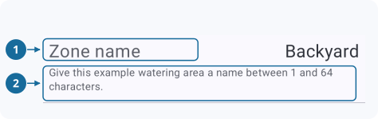
</figure>
</div>

<h3 id="edit-the-two-values" style="font-size:1.5rem;line-height:1.2;margin:1.5em 0 0.65em;">Edit the two values</h3>

Tap a value to open its editor.

<div style="display: flex; flex-wrap: wrap; gap: 24px; align-items: flex-start; margin: 20px 0;">
<div style="flex: 1 1 280px; min-width: 0;">
<figure style="margin: 0;">
<figcaption><strong>Zone name</strong> · edit the text, then choose OK.</figcaption>
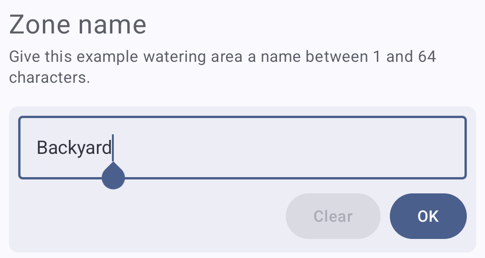
</figure>
<p><strong>RUST SOURCE · Daily watering limit</strong></p>
<pre style="white-space: pre-wrap; overflow-wrap: anywhere; padding: 12px; background: Canvas; color: CanvasText; border: 1px solid GrayText; border-radius: 8px; font-size: 0.85em; line-height: 1.5;"><code style="color: inherit; background: transparent;">/// Daily watering limit
/// Choose a whole number from 1 to 120 minutes per day. This preview does
/// not schedule watering or control equipment.
#[libertas_number(min = 1, max = 120, step = 1)]
#[libertas_default(20)]
#[libertas_physical_unit(&quot;minute&quot;)]
#[libertas_ui_include_description]
pub daily_limit_minutes: u32,</code></pre>
</div>
<figure style="flex: 1 1 280px; min-width: 0; margin: 0;">
<figcaption><strong>Daily watering limit</strong> · choose the number of minutes.</figcaption>

</figure>
</div>

<h3 id="complete-copyable-source" style="font-size:1.5rem;line-height:1.2;margin:1.5em 0 0.65em;">Complete, copyable source</h3>

Use the project setup from the [Rust manual](../reference/languages/rust.md),
with `libertas` and `libertas_macros` dependencies and an `rlib` library target.
`alloc` supplies the owned string. `LibertasExport` exposes the configuration
shape to schema tools; `LibertasAvroDecode` receives the configured value.

<details>
<summary>Show complete src/lib.rs</summary>

```rust
//! Guide showcase
//! Demonstrates forms using synthetic garden settings without controlling equipment.
//! #[libertas_default_locale("en")]

#![no_std]
#![forbid(unsafe_code)]

extern crate alloc;

use alloc::string::String;
use libertas_macros::*;

/// Garden settings
/// The example area name and daily limit used to demonstrate a configuration form.
#[derive(Clone, Debug, LibertasExport, LibertasAvroDecode)]
pub struct Configuration {
    /// Zone name
    /// Give this example watering area a name between 1 and 64 characters.
    /// [DefaultText]
    /// Backyard
    #[libertas_size(min = 1, max = 64)]
    #[libertas_ui_include_description]
    pub zone_name: String,

    /// Daily watering limit
    /// Choose a whole number from 1 to 120 minutes per day. This preview does
    /// not schedule watering or control equipment.
    #[libertas_number(min = 1, max = 120, step = 1)]
    #[libertas_default(20)]
    #[libertas_physical_unit("minute")]
    #[libertas_ui_include_description]
    pub daily_limit_minutes: u32,
}

/// Preview garden settings
/// Choose an example zone name and daily watering limit to explore the generated
/// configuration form. This demonstration does not water a garden or control
/// equipment. Developed by Example Developer (example_developer).
/// [DefaultTaskName]
/// Garden settings preview
#[libertas_export]
pub fn showcase(
    /// Garden settings
    /// The synthetic values used for this configuration example.
    configuration: Configuration,
) {
    let _ = configuration;
}
```

`display.json`, beside `Cargo.toml`, flattens the configuration so its two
fields sit directly under the task instead of beneath a **Garden settings**
row:

```json
{
  "DisplayVersion": 1,
  "rules": [
    { "select": "^<Configuration>", "flatten": { "name_row": false } }
  ]
}
```

</details>

Choose useful names, defaults, units, bounds, and explanations in the first
version. Every App author, including CodeBots, should complete these choices
before handing the App to a user. See the
[documentation contract](../reference/documentation.md) and
[annotation catalog](../reference/annotations.md) for their full rules.

Keep machine identity and visible wording separate. A field can retain the
native name `daily_limit_minutes` while its label is translated. Changing a
label should not require rewriting protocol mappings.

Defaults deserve a deliberate choice. An unanswered required value may remain
undefined until the user supplies it; undefined is not the same as a valid
nullable value. User and user-list configuration fields also need an explicit
schema Default when you want an initial recipient. They do not automatically
select the current user. A Default combined with static ReadOnly can describe
a mandatory notification list. The [initialization and type rules](../reference/schema.md)
explain the available representations.

**Checkpoint:** inspect the generated configuration. Can someone who has never
read the code explain each setting and recognize which required answers are
still missing?

<h3 id="shape-the-screen-with-uiheader" style="font-size:1.5rem;line-height:1.2;margin:1.5em 0 0.65em;">Shape the screen with promote and flatten</h3>

Now keep the values fixed and change only one `promote` or `flatten` rule in
`display.json`. `promote` selects a field of a struct; `flatten` selects a
struct, List, or Union. In every pair,
the garden area is **Backyard** and its daily limit is **20 min**. The two crops
come from the same client screen, retain the same horizontal origin, and use
the same display scale. Compare the row count, labels, and indentation.

<h4 id="first-a-union-chooses-the-example" style="font-size:1.2rem;line-height:1.2;margin:1.5em 0 0.65em;">First, a Union chooses the example</h4>

The comparison App offers several layouts through one configuration Union.
In Rust, each data-carrying enum variant defines one choice and its associated
fields. Selecting a choice opens that variant's fields. This selector is ordinary
Union presentation; it needs no rule.

<div style="display: flex; flex-wrap: wrap; gap: 24px; align-items: flex-start; margin: 20px 0;">
<div style="flex: 1 1 300px; min-width: 0;">
<p><strong>One variant from the comparison Union</strong></p>
<pre style="white-space: pre-wrap; overflow-wrap: anywhere; padding: 12px; background: Canvas; color: CanvasText; border: 1px solid GrayText; border-radius: 8px; font-size: 0.85em; line-height: 1.5;"><code style="color: inherit; background: transparent;">pub enum HeaderComparison {
    /// Scalar summary: parent name
    /// Promote the zone name using the owning row name.
    ScalarParent {
        /// Without UIHeader
        /// Promote the zone name using the owning row name.
        without_header: PlainZone,
        /// With UIHeader
        /// Promote the zone name using the owning row name.
        with_header: ParentSummary,
    },
    // Other comparison variants follow.
}</code></pre>
<p>The variant's first comment line appears in the choice list. Its fields are the two examples shown after selection; their labels, <strong>Without UIHeader</strong> and <strong>With UIHeader</strong>, are this comparison App's own names. The capture shows the first four choices; more are available by scrolling.</p>
</div>
<figure style="flex: 1 1 300px; min-width: 0; margin: 0;"><figcaption><strong>Union choice selector</strong></figcaption>
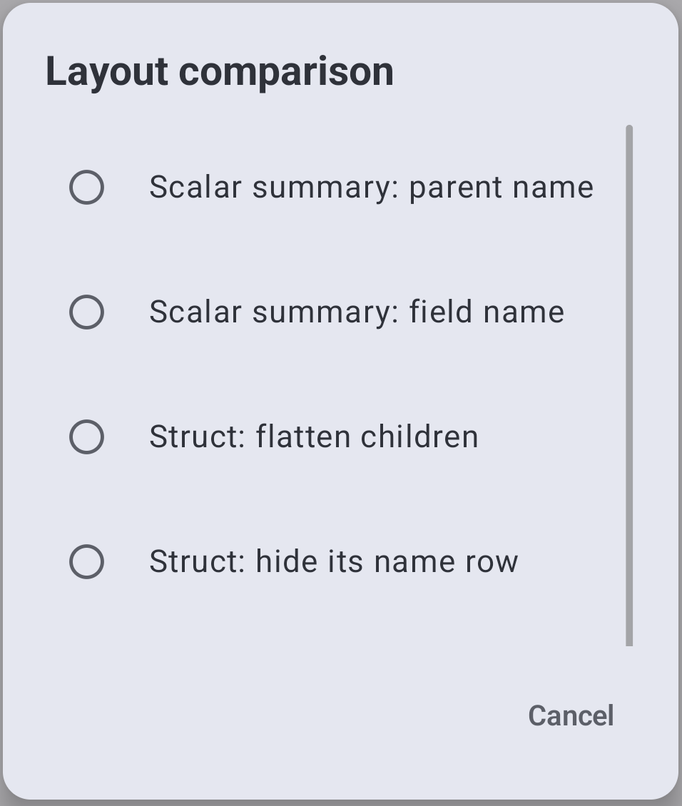
</figure>
</div>

<h4 id="1-put-a-fields-value-on-its-parent-row" style="font-size:1.2rem;line-height:1.2;margin:1.5em 0 0.65em;">1. Put a field's value on its parent row</h4>

Select the **field** with a `promote` rule. The value **Backyard** moves to
the owning row, so the separate **Zone name** row disappears. The owning row
keeps its label—**With UIHeader** in this comparison. The unselected **Daily limit**
remains below it.

<div style="display: flex; flex-wrap: wrap; gap: 24px; align-items: flex-start; margin: 20px 0;">
<figure style="flex: 1 1 300px; min-width: 0; margin: 0;"><figcaption><strong>Without the rule</strong></figcaption>
<pre style="white-space: pre-wrap; overflow-wrap: anywhere; padding: 12px; background: Canvas; color: CanvasText; border: 1px solid GrayText; border-radius: 8px; font-size: 0.85em; line-height: 1.5; min-height: 3.0em;"><code style="color: inherit; background: transparent;">pub zone_name: String;</code></pre>
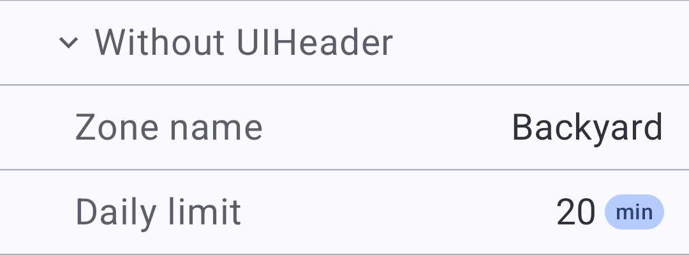
</figure>
<figure style="flex: 1 1 300px; min-width: 0; margin: 0;"><figcaption><strong>With the rule</strong></figcaption>
<pre style="white-space: pre-wrap; overflow-wrap: anywhere; padding: 12px; background: Canvas; color: CanvasText; border: 1px solid GrayText; border-radius: 8px; font-size: 0.85em; line-height: 1.5; min-height: 3.0em;"><code style="color: inherit; background: transparent;">{ "select": "^&lt;ParentSummary&gt;.zone_name",
  "promote": true }</code></pre>
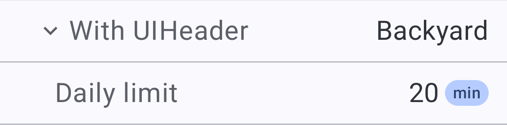
</figure>
</div>

<h4 id="2-keep-the-promoted-fields-name-instead" style="font-size:1.2rem;line-height:1.2;margin:1.5em 0 0.65em;">2. Keep the promoted field's name instead</h4>

The field rule still promotes **Backyard**. With `"use_parent_name": false`,
the promoted row is labeled **Zone name** instead of **With UIHeader**.
The option chooses the label; it does not turn promotion off.

<div style="display: flex; flex-wrap: wrap; gap: 24px; align-items: flex-start; margin: 20px 0;">
<figure style="flex: 1 1 300px; min-width: 0; margin: 0;"><figcaption><strong>Without the rule</strong></figcaption>
<pre style="white-space: pre-wrap; overflow-wrap: anywhere; padding: 12px; background: Canvas; color: CanvasText; border: 1px solid GrayText; border-radius: 8px; font-size: 0.85em; line-height: 1.5; min-height: 6.0em;"><code style="color: inherit; background: transparent;">pub zone_name: String;</code></pre>

</figure>
<figure style="flex: 1 1 300px; min-width: 0; margin: 0;"><figcaption><strong>With the rule</strong></figcaption>
<pre style="white-space: pre-wrap; overflow-wrap: anywhere; padding: 12px; background: Canvas; color: CanvasText; border: 1px solid GrayText; border-radius: 8px; font-size: 0.85em; line-height: 1.5; min-height: 6.0em;"><code style="color: inherit; background: transparent;">{ "select": "^&lt;FieldSummary&gt;.zone_name",
  "promote": {
    "use_parent_name": false } }</code></pre>
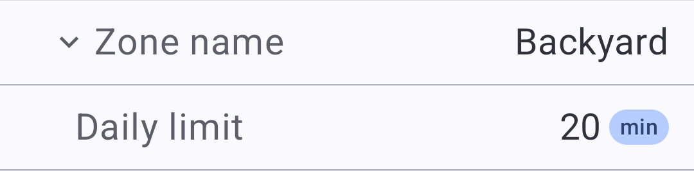
</figure>
</div>

<h4 id="3-flatten-a-structs-children" style="font-size:1.2rem;line-height:1.2;margin:1.5em 0 0.65em;">3. Flatten a struct's children</h4>

Select the **struct type** with a `flatten` rule. The **With UIHeader** heading
remains, and both child fields move left. No field value is promoted into that
heading. This is a different effect from selecting a field.

<div style="display: flex; flex-wrap: wrap; gap: 24px; align-items: flex-start; margin: 20px 0;">
<figure style="flex: 1 1 300px; min-width: 0; margin: 0;"><figcaption><strong>Without the rule</strong></figcaption>
<pre style="white-space: pre-wrap; overflow-wrap: anywhere; padding: 12px; background: Canvas; color: CanvasText; border: 1px solid GrayText; border-radius: 8px; font-size: 0.85em; line-height: 1.5; min-height: 7.5em;"><code style="color: inherit; background: transparent;">pub struct PlainZone {
    pub zone_name: String,
    pub daily_limit_minutes: u32,
}</code></pre>

</figure>
<figure style="flex: 1 1 300px; min-width: 0; margin: 0;"><figcaption><strong>With the rule</strong></figcaption>
<pre style="white-space: pre-wrap; overflow-wrap: anywhere; padding: 12px; background: Canvas; color: CanvasText; border: 1px solid GrayText; border-radius: 8px; font-size: 0.85em; line-height: 1.5; min-height: 7.5em;"><code style="color: inherit; background: transparent;">{ "select": "^&lt;FlatZone&gt;",
  "flatten": true }</code></pre>
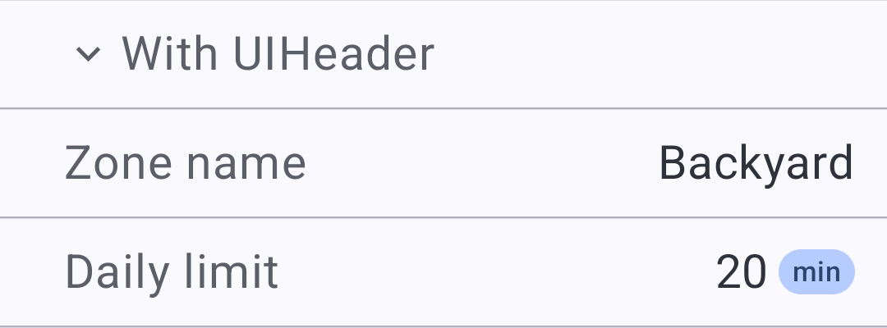
</figure>
</div>

<h4 id="4-flatten-and-hide-the-structs-name-row" style="font-size:1.2rem;line-height:1.2;margin:1.5em 0 0.65em;">4. Flatten and hide the struct's name row</h4>

Keep the `flatten` rule on the **struct type**, and set `"name_row": false`.
Both fields remain visible and editable, but the **With UIHeader** name-only
row disappears. The right-hand caption belongs to this guide; it is not an
extra row added to the captured client UI.

<div style="display: flex; flex-wrap: wrap; gap: 24px; align-items: flex-start; margin: 20px 0;">
<figure style="flex: 1 1 300px; min-width: 0; margin: 0;"><figcaption><strong>Without the rule</strong></figcaption>
<pre style="white-space: pre-wrap; overflow-wrap: anywhere; padding: 12px; background: Canvas; color: CanvasText; border: 1px solid GrayText; border-radius: 8px; font-size: 0.85em; line-height: 1.5; min-height: 10.5em;"><code style="color: inherit; background: transparent;">pub struct PlainZone {
    pub zone_name: String,
    pub daily_limit_minutes: u32,
}</code></pre>

</figure>
<figure style="flex: 1 1 300px; min-width: 0; margin: 0;"><figcaption><strong>With the rule</strong></figcaption>
<pre style="white-space: pre-wrap; overflow-wrap: anywhere; padding: 12px; background: Canvas; color: CanvasText; border: 1px solid GrayText; border-radius: 8px; font-size: 0.85em; line-height: 1.5; min-height: 10.5em;"><code style="color: inherit; background: transparent;">{ "select": "^&lt;UnnamedZone&gt;",
  "flatten": {
    "name_row": false } }</code></pre>
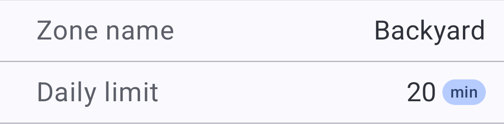
</figure>
</div>

The declarations are identical in each pair; only the `display.json` rule
differs. `promote` and `flatten` change presentation; the fields and their
encoded data hierarchy stay intact. For `promote`, `true` means
`"use_parent_name": true`. Removing a rule removes its layout effect. See the
[full promotion contract](../reference/presentation.md#tableheader-promoted-fields-and-union-selectors)
and [flattening](../reference/presentation.md#flatten) for Union and List
flattening and their combinations, and
[labels and titles](../reference/presentation.md#labels-and-titles) for replacing a row's
displayed name from its data.

<a id="4-give-the-running-task-a-conversation"></a>

<a id="4-requests-become-actions"></a>

<h2 id="4-runtime-interaction-is-a-protocol" style="font-size:2rem;line-height:1.2;margin:1.5em 0 0.65em;">4. Runtime interaction is a protocol</h2>

A protocol is a Union type with four message types:

- Request
- Response
- Subscription Request
- Subscription Data

<a id="5-carry-received-data-into-the-next-request"></a>

<a id="5-data-carries-the-conversation"></a>

<a id="5-protocol-state-transition-is-just-an-annotation-with-a-comment"></a>

<a id="5-annotations-describe-what-happens-next"></a>

<h2 id="5-annotations-declare-protocol-state-transitions" style="font-size:2rem;line-height:1.2;margin:1.5em 0 0.65em;">5. Annotations declare protocol state transitions</h2>

**Start with the data already on screen.** The subscription view shows the
current garden settings. Its annotations lead the user from data to action.

<div style="display:flex;flex-wrap:wrap;gap:24px;align-items:flex-start;margin:20px 0;">
<div style="flex:1 1 300px;min-width:0;">
<p><strong>1. Display SubscriptionData</strong></p>
<pre style="white-space:pre-wrap;overflow-wrap:anywhere;padding:12px;background:Canvas;color:CanvasText;border:1px solid GrayText;border-radius:8px;font-size:0.85em;line-height:1.5;"><code style="color:inherit;background:transparent;">/// Live garden settings
/// Current synthetic values shared by all viewers of this task. Choose an action to edit one setting.
#[libertas_response]
#[libertas_subscription_data]
// NextRequest is shown in the next step.
Snapshot {
    // Other snapshot fields omitted.
    /// Daily watering limit
    /// The current demonstration limit; no physical watering is performed.
    #[libertas_read_only]
    #[libertas_physical_unit(&quot;minute&quot;)]
    daily_limit_minutes: u32,
}</code></pre>
</div>
<figure style="flex:1 1 300px;min-width:0;margin:0;">
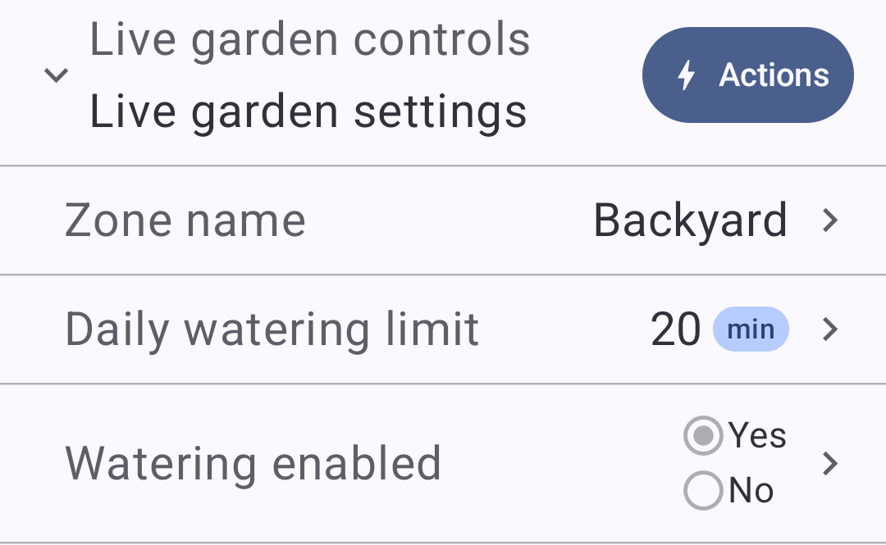
<figcaption>The current data is the starting point: Backyard, 20 min, watering enabled.</figcaption>
</figure>
</div>

**Annotations declare the transitions; comments explain them.** Rust processes
these annotations without generating executable code; Studio extracts them
into the schema.

Tap **Actions**. `NextRequest` offers three requests in the declared order.

<div style="display:flex;flex-wrap:wrap;gap:24px;align-items:flex-start;margin:20px 0;">
<div style="flex:1 1 300px;min-width:0;">
<p><strong>2. NextRequest offers the actions</strong></p>
<pre style="white-space:pre-wrap;overflow-wrap:anywhere;padding:12px;background:Canvas;color:CanvasText;border:1px solid GrayText;border-radius:8px;font-size:0.85em;line-height:1.5;"><code style="color:inherit;background:transparent;">/// Live garden settings
/// Current synthetic values shared by all viewers of this task. Choose an action to edit one setting.
#[libertas_response]
#[libertas_subscription_data]
#[libertas_next_request(&quot;RenameZone,ChangeDailyLimit,SetWateringEnabled&quot;)]
Snapshot {
    // Snapshot fields omitted from this excerpt.
}</code></pre>
</div>
<figure style="flex:1 1 300px;min-width:0;margin:0;">
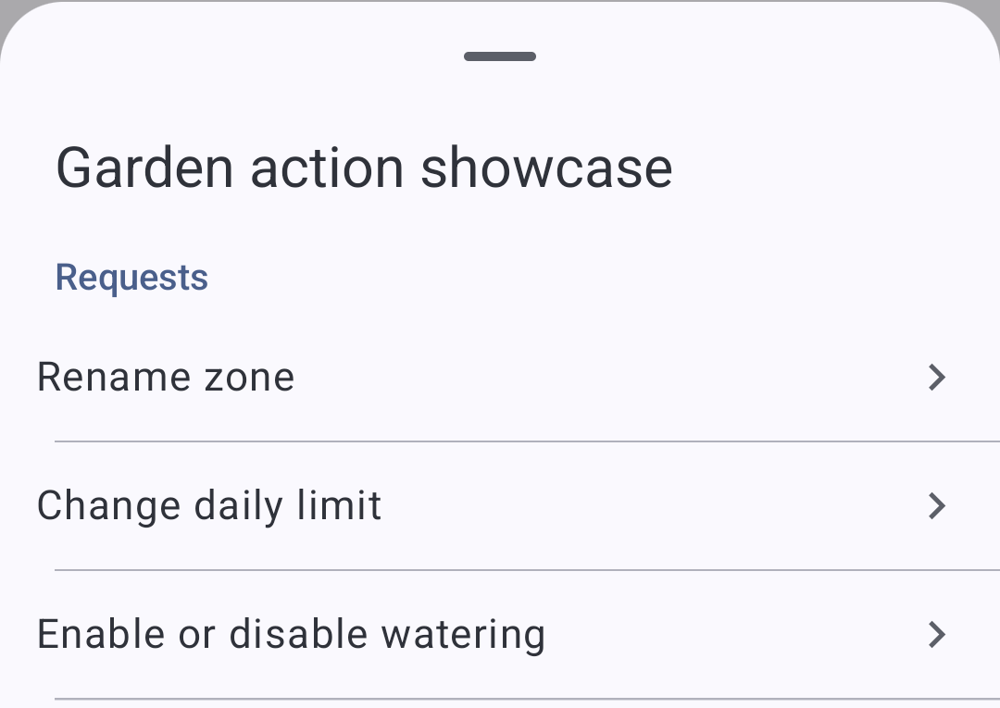
<figcaption>The chooser offers Rename zone, Change daily limit, and Enable or disable watering.</figcaption>
</figure>
</div>

Select **Change daily limit**. `CopyFrom` reads the received value into the
request: **20 on screen → 20 in the editor**. The user can change it to 30.
`NextResponse(Updated)` declares the expected acknowledgement.

<div style="display:flex;flex-wrap:wrap;gap:24px;align-items:flex-start;margin:20px 0;">
<div style="flex:1 1 300px;min-width:0;">
<p><strong>3. CopyFrom initializes the chosen request</strong></p>
<pre style="white-space:pre-wrap;overflow-wrap:anywhere;padding:12px;background:Canvas;color:CanvasText;border:1px solid GrayText;border-radius:8px;font-size:0.85em;line-height:1.5;"><code style="color:inherit;background:transparent;">/// Change daily limit
/// Change the maximum watering time shown in this demonstration.
#[libertas_request]
#[libertas_access_privilege(&quot;Write&quot;)]
#[libertas_next_response(Updated)]
ChangeDailyLimit {
    /// Daily watering limit
    /// Choose a whole number from 1 to 120 minutes per day.
    #[libertas_copy_from(&quot;$.daily_limit_minutes&quot;)]
    #[libertas_number(min = 1, max = 120, step = 1)]
    #[libertas_physical_unit(&quot;minute&quot;)]
    #[libertas_ui_include_description]
    daily_limit_minutes: u32,
},</code></pre>
</div>
<figure style="flex:1 1 300px;min-width:0;margin:0;">
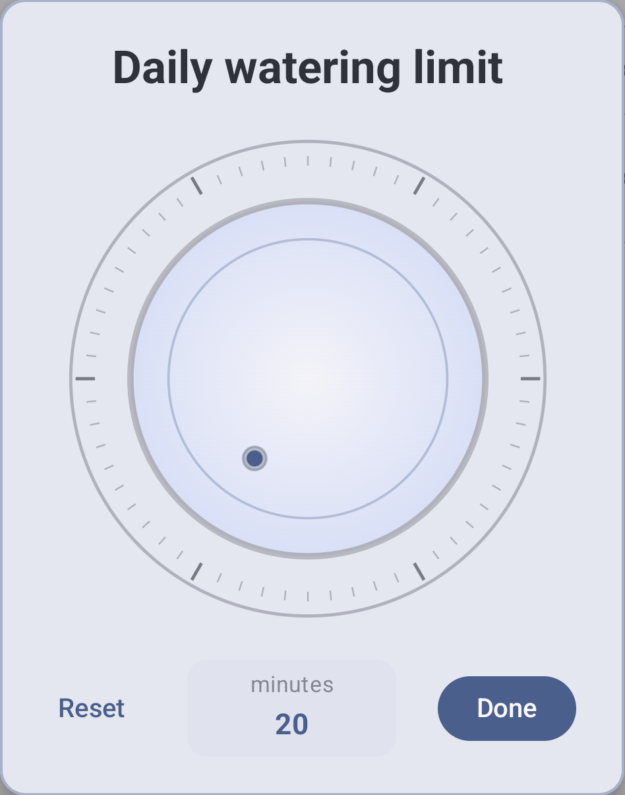
<figcaption>The daily-limit editor opens with the copied value 20, labeled in minutes.</figcaption>
</figure>
</div>

<a id="6-validate-with-the-information-you-actually-have"></a>
<a id="6-make-valid-input-easy"></a>

**Annotations also define valid input.** Here, Number limits the editor to
1–120 minutes. RangeMin, RangeMax, and ValidationRules can use server-supplied
data; handle null before the first response. The server validates submissions.
See [validation rules](../reference/validation-rules.md).

CopyFrom uses the interaction's [reference context](../reference/protocols.md#interaction-reference-context).
It reads received data without fetching from the server. Carry continuation and
initialization-only data in [hidden fields](../reference/protocols.md#hidden-protocol-context).

<a id="7-keep-the-displayed-state-current"></a>
<a id="7-live-data-stays-live"></a>
<a id="6-live-data-stays-live"></a>

<h2 id="6-the-server-updates-the-live-view" style="font-size:2rem;line-height:1.2;margin:1.5em 0 0.65em;">6. The server updates the live view</h2>

**The request changes the data. The subscription brings it back.**
For example, change the limit from 20 to 30 and submit:

| Direction | Message | Effect |
| --- | --- | --- |
| Client → App | `ChangeDailyLimit { daily_limit_minutes: 30 }` | The App accepts the new limit. |
| App → subscribers | `Snapshot { …, daily_limit_minutes: 30, … }` | The live view displays 30. |
| App → requesting client | `Updated` | Acknowledges the submitted request. |

This showcase reports the change before acknowledging the request. The
acknowledgement completes that request; subscription data updates the view.
Submitting an unchanged value receives an acknowledgement without a duplicate
report. Reopen **Change daily limit** and CopyFrom now supplies **30**.

**Check the full loop:** submit 30, watch a second subscribed view update, then
reopen the editor. The screenshots above show the starting view and editor;
this check exercises the return path. The demonstration keeps values only
until task restart and controls no equipment.

Apps can report complete snapshots or [compatible reduced updates](../reference/protocols.md#compatible-subscriptiondata).
Array replacement and explicit append are separate operations.

<details>
<summary><strong>How the subscription view opens</strong></summary>

The first fieldless SubscriptionRequest, `Watch`, is the default subscription.
The App answers it with a complete correlated `Snapshot` Response; later
changes arrive as SubscriptionData reports. A report alone does not complete
the opening request. See [subscription runtime rules](../reference/protocols.md#endpoint-runtime-rules).

<pre style="white-space:pre-wrap;overflow-wrap:anywhere;padding:12px;background:Canvas;color:CanvasText;border:1px solid GrayText;border-radius:8px;font-size:0.85em;line-height:1.5;"><code style="color:inherit;background:transparent;">/// Watch garden settings
/// Open the current settings and receive later changes while subscribed.
#[libertas_request]
#[libertas_subscription_request]
#[libertas_access_privilege(&quot;Read&quot;)]
#[libertas_next_response(Snapshot)]
Watch,</code></pre>

The task configuration supplies the starting values and names its Endpoint.

<div style="display:flex;flex-wrap:wrap;gap:24px;align-items:flex-start;margin:20px 0;">
<div style="flex:1 1 300px;min-width:0;">
<p><strong>Configure the starting values and create the endpoint</strong></p>
<pre style="white-space:pre-wrap;overflow-wrap:anywhere;padding:12px;background:Canvas;color:CanvasText;border:1px solid GrayText;border-radius:8px;font-size:0.85em;line-height:1.5;"><code style="color:inherit;background:transparent;">    /// Live garden controls
    /// Open this endpoint to watch settings and choose an action. Changes require write access.
    /// [DefaultText]
    /// Garden action showcase
    #[libertas_endpoint_schema(GardenActions)]
    #[libertas_endpoint_server]
    controls: libertas::LibertasEndpoint,</code></pre>
</div>
<figure style="flex:1 1 300px;min-width:0;margin:0;">
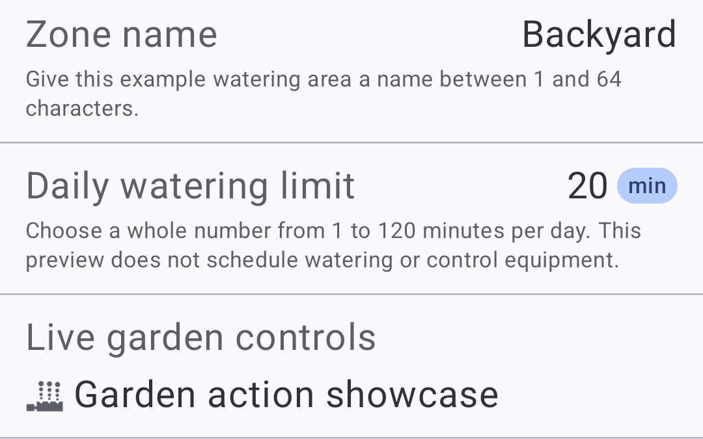
<figcaption>Task configuration supplies starting values and names the server endpoint.</figcaption>
</figure>
</div>

</details>

<a id="one-model-many-languages"></a>

<h2 id="comprehensive-localization-and-charts" style="font-size:2rem;line-height:1.2;margin:1.5em 0 0.65em;">7. Comprehensive localization and charts</h2>

**Localization reaches every detail: names, descriptions, numbers, physical
units, chart titles, axes, and tooltips.**

The final visual example is **Compare languages and physical units**. Its
configuration form contains air temperature **22.5 Celsius**, water volume
**12.5 liters**, and water flow **2.5 liters per minute**. Its water-flow chart
uses five synthetic readings around that configured flow. Nothing controls
equipment or changes the measurement system when the viewing language changes.

<div style="display:flex;flex-wrap:wrap;gap:24px;align-items:flex-start;margin:20px 0;">
<div style="flex:1 1 300px;min-width:0;">
<p><strong>One numeric field, one canonical unit</strong></p>
<pre style="white-space:pre-wrap;overflow-wrap:anywhere;padding:12px;background:Canvas;color:CanvasText;border:1px solid GrayText;border-radius:8px;font-size:0.85em;line-height:1.5;"><code style="color:inherit;background:transparent;">/// Water flow
/// The example flow in liters per minute. The chart varies around this value.
#[libertas_default(2.5)]
#[libertas_number(min = 0, max = 10, step = 0.5)]
#[libertas_physical_unit(&quot;liter-per-minute&quot;)]
#[libertas_format(&quot;0.#&quot;)]
#[libertas_ui_include_description]
pub flow: f64,</code></pre>
<p>The translated document supplies 水流量 and its description. The client displays <code>liter-per-minute</code> as 升/分钟. The value remains 2.5.</p>
</div>
<figure style="flex:1 1 300px;min-width:0;margin:0;">
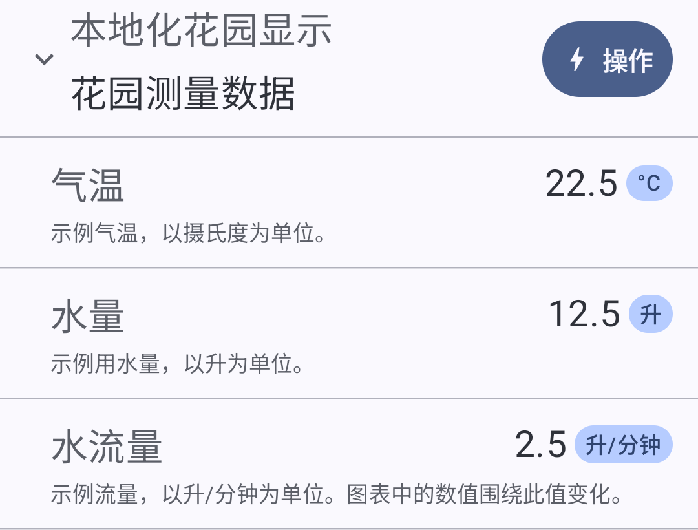
<figcaption>Simplified Chinese labels and units in the measurement summary. The Celsius symbol stays °C.</figcaption>
</figure>
</div>

**All physical units are localizable, including compound units.** Translate
the source-derived names and descriptions through the App's locale document;
the client formats unit labels for its viewing locale. On charts, the same
metadata supplies localized measurement presentation for axes and tooltips.
Keep `liter-per-minute` in the schema and `2.5` in the payload. Do not translate
the identifier, append a unit to a numeric string, or change liters into another
unit merely because the language changes.

| Schema unit vocabulary | Count |
| --- | ---: |
| Simple units in the current CLDR 48 vocabulary | 160 |
| Prefixes | 32 |
| Units accepting those prefixes | 39 |
| Distinct simple or prefixed identifiers | 1,407 |

Compound units are generated rather than chosen from a fixed list, so there is
**no finite catalog count of all combinations**. Powers, products, and ratios
include `square-meter`, `kilowatt-hour`, and `liter-per-minute`. These counts
describe schema vocabulary, not a guarantee that every installed client's
formatter recognizes every identifier. See [physical units](../reference/presentation.md#physical-units)
for the supported fallback when a formatter lacks a unit.

<a id="the-same-chart-in-two-languages"></a>

<h3 id="charts-in-2d-and-3d" style="font-size:1.5rem;line-height:1.2;margin:1.5em 0 0.65em;">Charts in 2D and 3D</h3>

**[Explore the chart gallery](chart-gallery.md)** · Twenty 2D and twelve 3D views,
from lines and radar to surfaces and point clouds.

**Cartesian, polar, and 3D charts.** The current galleries demonstrate
**22 2D examples and 13 3D families**, including:

| Family | Supported chart styles |
| --- | --- |
| 2D Cartesian | Scatter, bubble, line, area, grouped and stacked bars, stacked area, histogram, heatmap, error bars, confidence bands, candlestick, OHLC, box plot, projected maps, networks, Sankey flows |
| 2D polar | Polar scatter and line plots, radar, pie, donut, radial bars, polar ranges |
| 3D | Scatter, trajectories, bars/columns, bubbles, height maps, wireframes, surface contours, nonuniform surfaces, waterfall spectra, impulse/stem, parametric surfaces, point clouds, combined series |

These are examples, not a fixed ceiling on chart styles. Layering, facets, and
horizontal or vertical layouts create further combinations. See the
[2D chart contract](../reference/charts/2d.md) and
[3D families](../reference/charts/3d.md#10-supported-families).

**The same chart in two languages:**

The English and Simplified Chinese captures below contain the same five
readings. Compare **Water flow / 水流量**, **Elapsed time / 已用时间**, and
**L/min / 升/分钟**. The values and curve stay the same; the client allows
space for each language's axis labels. Both crops use the same dimensions and
display scale. Select an image to inspect its labels at full resolution.

<figure style="margin:20px 0;">
<a href="../assets/screenshots/localized-chart-en.png">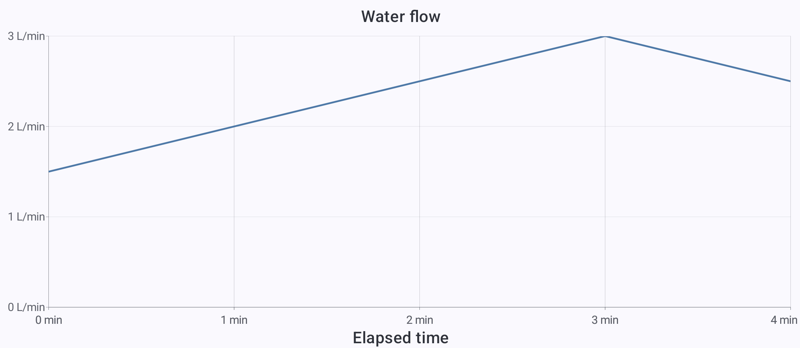</a>
<figcaption>English: the same measurement metadata localizes the axis labels and units.</figcaption>
</figure>

<figure style="margin:20px 0;">
<a href="../assets/screenshots/localized-chart-zh.png">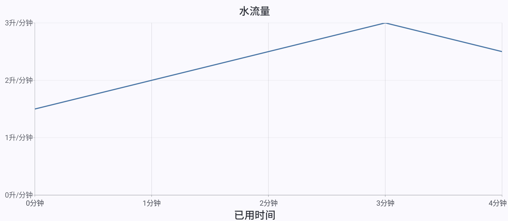</a>
<figcaption>Simplified Chinese: the same measurement metadata localizes the axis labels and units.</figcaption>
</figure>

The chart's numeric field uses the same unit identifier as the form:

```rust
/// Water flow
/// Liters per minute at this point in the demonstration.
#[libertas_chart_channel(y, tooltip)]
#[libertas_chart_scale(id = flow, kind = linear, min = 0, zero = true)]
#[libertas_chart_guide(target = y, source = scale, position = left)]
#[libertas_physical_unit("liter-per-minute")]
#[libertas_format("0.#")]
pub flow: f64,
```

The matching time field carries `PhysicalUnit("minute")`. The screenshots show
axes without an open tooltip. The earlier [portrait capture](../assets/screenshots/localized-chart-portrait-en.png)
shows the same data in a narrower chart layout. Prepare App text with the
[translation workflow](translation.md). These examples complete the visual
tour; use the annotation reference to look up other decorators as needed.

<a id="8-preserve-useful-records-and-present-them-clearly"></a>

<a id="8-persist-facts-preserve-meaning"></a>

<a id="7-persist-facts-preserve-meaning"></a>

<h2 id="8-a-union-describes-persistent-data" style="font-size:2rem;line-height:1.2;margin:1.5em 0 0.65em;">8. A Union describes persistent data</h2>

**Declare the data structures your App needs as variants of a Union.**
The same comments supply localized names and descriptions.
Your App reads and writes these values through the Data API; the platform owns
[default persistence-failure handling](../reference/protocols.md#persistence-failure-and-the-no-status-api).

<a id="9-extend-the-conversation-into-a-workflow"></a>
<a id="9-let-the-server-lead-the-workflow"></a>
<a id="8-let-the-server-lead-the-workflow"></a>
<a id="10-deploy-inspect-and-exercise-the-whole-interaction"></a>
<a id="10-prove-the-interaction"></a>
<a id="9-prove-the-interaction"></a>
<a id="continue-with-your-own-app"></a>

<h2 id="9-further-reading" style="font-size:2rem;line-height:1.2;margin:1.5em 0 0.65em;">9. Further reading</h2>

- [Rust manual](../reference/languages/rust.md) and [TypeScript manual](../reference/languages/typescript.md)
- [App recipes](../examples/app-recipes.md)
- [Schema annotations](../reference/annotations.md)
- [Protocols and workflows](../reference/protocols.md)
- [Client-side form caching: CacheIdentity](../reference/annotations.md#cacheidentity)
- [Translation](translation.md) and [charts](visualization.md)
- [Deploy with Studio](studio.md#deploying-to-a-hub)
- [Troubleshooting](troubleshooting.md)

<h2 id="10-prompt-a-codebot-to-build-your-app" style="font-size:2rem;line-height:1.2;margin:1.5em 0 0.65em;">10. Prompt a CodeBot to build your App</h2>

**Describe what you want. Let the CodeBot build it against the contract.**

Draft prompt—replace the brackets. The contract URLs are placeholders; the
current references are the [CodeBot kit](../codebot/index.md) and
[App contract](../reference/app-contract.md).

<pre style="white-space:pre-wrap;overflow-wrap:anywhere;padding:12px;background:Canvas;color:CanvasText;border:1px solid GrayText;border-radius:8px;font-size:0.95em;line-height:1.5;"><code style="color:inherit;background:transparent;">Build a Libertas App that [what it should accomplish].
Use [Rust or TypeScript].

People should be able to [view and change these things].
It should automatically [actions and triggers].
It must remember [data that survives restart].
It connects to [devices or services, or none].

Read the official CodeBot kit: [OFFICIAL_CODEBOT_KIT_URL]
Follow the App contract: [OFFICIAL_APP_CONTRACT_URL]
Follow their links for the language and features this App needs.

Use the smallest design that remains logically complete.
Use supported SDK APIs and annotations; do not invent missing behavior.
Provide clear UI names, descriptions, defaults, units, and validation.
Implement the App, run language checks and Studio schema validation,
and report what works and what still needs testing or deployment.</code></pre>

[All human guides](index.md)
