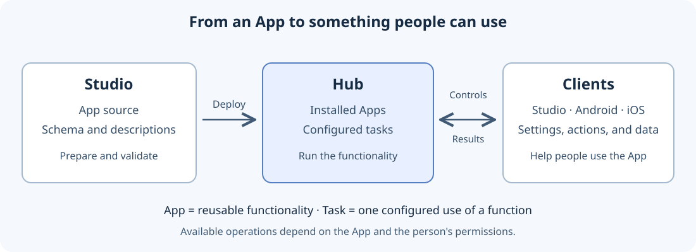

# Getting started

Begin by deciding whether you want to use an existing App or develop one.
Both workflows use a Hub, but only App development requires a source project
and language toolchain.

## Meet the main components

**The Hub** runs Apps and their configured tasks. **Studio** is the VS Code
extension for working with App projects, validation, deployment, and
administration. **Android and iOS clients** let people administer the Hub and
use task controls and results, subject to their permissions.

An **App package** contains reusable functionality. A **function** is an
entry point for a task. A **task** supplies the settings for one running use
of that function. An App may also publish shared types without executable
functions; such a package does not offer a task to create.

## Use an existing App

Have access to a configured Hub and the permissions needed for installation
and task creation. Start with [Administration](administration.md) to inspect
Installed Apps, choose a function, and create a task. Read its description and
requested permissions before configuring it.

Once the task is available, continue with [Task controls](control.md) to use
its actions and read its results. The controls depend on what the App provides.

## Develop an App

Start with [Using Studio](studio.md), then [the App-development tutorial](developing-apps.md).
You will choose a language, define the App in source, validate it, deploy to a
selected Hub, and create a task to exercise it. Publishing it for other people
is a later, separate [Plaza workflow](plaza.md).

[All human guides](index.md)
