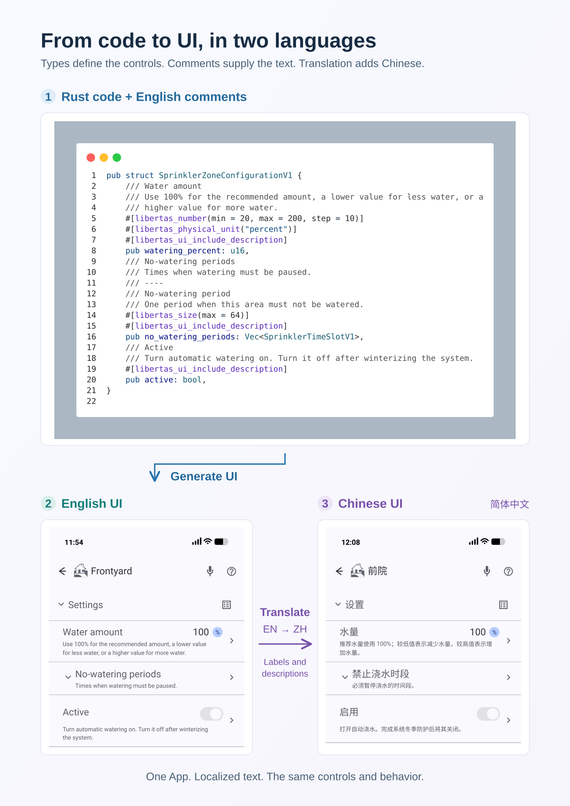

# Libertas Schema Document Translation Guide

The parser-generated default-locale document and schema signature are the
structural authority. Translation changes localized text only. It never changes
schema structure, identifiers, numeric IDs, or runtime behavior.

[](../assets/diagrams/code-to-localized-ui-a4.svg)

*Sprinkler configuration example: types and constraints define the controls;
English source comments provide labels and descriptions. Translating that text
produces a Chinese interface with the same controls and behavior.*
[Open the portrait A4 diagram](../assets/diagrams/code-to-localized-ui-a4.svg) to
inspect the code and both interfaces, or
[download its PNG](../assets/diagrams/code-to-localized-ui-a4.png).
The wide layout is also available as an
[SVG](../assets/diagrams/code-to-localized-ui.svg) or
[PNG](../assets/diagrams/code-to-localized-ui.png).

Translated text follows the [user-language invariant](../reference/documentation.md#universal-user-language-invariant):
natural wording that describes what people can do and understand.

Codebots that author the default-locale source must first follow the
[schema documentation contract](../reference/documentation.md)
for every schema-visible node, custom property, and string resource. This guide
then governs how that complete default document is translated.

## Before you begin

Open a file in the package and run **Libertas: Translate** from the Command
Palette. Studio detects the package from the active editor or workspace. If it
needs a package choice, it asks. Choose the Hub containing the installed App;
Studio skips this picker when only one Hub is configured. The command loads
that Hub's current schema and translations and opens the same **App Translation**
screen as the Admin panel. Install or deploy the App to that Hub first if its
metadata is unavailable.

An **App Translation** screen opened from a Hub already has the selected Hub:
that connection supplied its current translations and receives the import.
No second Hub selection or **OK** step is required. A Schema Editor opened
explicitly in local mode has only project files; select the intended Hub
workflow when you need an immediate Hub update.

The locale-picker instructions below describe Studio builds with **Other
locale...** available. If your installed build lacks it, use an offered locale
or update Studio before following the manual-tag steps.

## Translation workspace

For a local project, Libertas Studio keeps the translation handoff under the
project root:

```text
developer-package/
├── src/
└── translations/
    ├── manifest.json
    ├── TRANSLATION-CODEBOT.md
    ├── TRANSLATION-CHATBOT.md
    ├── CODEX_TRANSLATION.md
    ├── TRANSLATION-WORKSET.json
    ├── TRANSLATION-RESULT.json
    ├── developer-package.en.doc.json
    └── developer-package.fr-FR.doc.json
```

The directory is intentionally visible and durable. It may be reviewed and
committed with the project. Studio does not place translation inputs in `src/`
and does not delete them after import.

When the Schema Editor was opened from a Hub or the Admin panel, it has no source
file path of its own. Studio first resolves the exact matching package from
active or visible editors and then from all Libertas projects in the open
workspace. It never writes translation artifacts into an unrelated package. If
duplicate local projects have the same package name, Studio asks which project
directory to use. If there is no matching local project, Studio creates a
durable per-package workspace under the extension's global storage and opens
the generated prompt from there. The completion message shows the exact
`translations/` path used for saving and importing the result.

`manifest.json` records the exact schema signature, structural document hash,
and trusted per-locale Codex baselines. Studio uses those signatures when a
later schema inserts, removes, or reorders fields. Existing localized text
follows the same native declaration path rather than its old array position or
numeric ID. A baseline is trusted only while its recorded target-document hash
matches the locale currently open in the editor.

## Choosing a locale

**+ New Locale...**, **Translate with Codex**, **Codebot Prompt**, and **Chatbot
Prompt** offer popular locales searchable by tag or language name. Choose
**Other locale...** to enter any locale tag accepted by the
[translation contract](../reference/translation.md), such as `uk-UA` or `sr-Latn-RS`.
The popular Chinese choices are `zh-Hans` (Simplified) and `zh-Hant`
(Traditional); `zh-CN` and `zh-TW` remain accepted without renaming existing
documents.

Translation actions also list existing locales so they can be updated. The
default locale cannot be a translation target. **+ New Locale...** excludes all
existing locales and then asks which existing locale to copy from. These
restrictions also apply to manually entered tags.

## Translate with Codex

1. Open the **Schema Editor** for the package you intend to translate.
2. Select **Translate with Codex**, check one or more target locales, and confirm
   the selection. Choose **Other locales...** to add tags separated by commas or
   spaces, such as `uk-UA, sr-Latn-RS, fr-CA`. Duplicate tags are translated once.
   If the selection includes existing locales, keep **Automatic update** or
   choose **Fresh translation** for those locales before the queue starts.
   Use **Fresh translation** to improve wording throughout an existing locale;
   **Automatic update** preserves text whose source has not changed.
3. Studio queues the selected locales and processes them one at a time. For each
   locale, it exports the normalized default document and schema manifest, then
   generates `TRANSLATION-WORKSET.json` and `CODEX_TRANSLATION.md`.
   - A new locale, an untrusted/missing baseline, or **Fresh translation** puts
     every localizable value in the workset.
   - A trusted existing locale uses an incremental workset containing only new
     values and values whose default-locale source text changed.
4. Studio uses **GPT-5.6 Sol** with **medium** reasoning to translate the text
   directly, with shell commands, agent delegation, and web access disabled.
   The Codex client is forced to use **Sign in with ChatGPT**;
   Studio never requests, stores, or forwards an OpenAI API key.
5. Progress identifies the current locale and its position in the queue, then
   shows the number of translated values as each batch completes. Codex returns
   translated strings directly;
   it does not read or write project files. Incremental translation sends only
   new or changed values, avoiding retranslating unchanged document text.
6. After all batches succeed, Studio validates the exact result paths and
   values, saves `TRANSLATION-RESULT.json`, merges the complete document,
   writes `developer-package.<locale>.doc.json`, and
   validates its locale, complete structural hash, and schema migration before
   adding it to the editor. Codex never merges or rewrites unchanged values.
7. In a Hub-connected editor, Studio immediately uploads each finished
   translation to that Hub, retaining all other locales. It waits for that
   upload to succeed before starting the next queued locale. It also saves
   the normal `.doc.json` project file when a
   local project is open. A purely local editor saves locally; it has no Hub
   destination and does not claim an upload.
   Import does not wait for **OK**, **Submit**, or an editor acknowledgement.
   The imported locale remains open for review after the upload succeeds.

You can cancel the queue from the progress notification. Cancellation stops
the active translation and skips the remaining locales. An upload already in
progress is allowed to finish. A translation failure, a batch taking more than
three minutes, or an upload failure also stops the queue and identifies the
failed locale. Earlier saves and uploads are retained. An incomplete
locale is not uploaded; a complete locale whose upload failed remains available
in its `.doc.json` file for import and retry. Select **Translate with Codex**
again to queue unfinished locales. While a queue runs, finish or cancel it
before starting another translation or saving other document changes.

Each locale keeps its own `.doc.json` file and incremental baseline. Shared
workset and prompt files are replaced for each locale; `TRANSLATION-RESULT.json`
is replaced only when a translation finishes.

If a trusted baseline produces no changed values, Studio synchronizes document
structure without invoking Codex and persists it through the same immediate
import path. A successful import records the translation baseline; subsequent
saved edits refresh its target hash. Closing the editor cancels the remaining
queue without undoing an imported translation. The Hub handles fresh and
incremental translations in the same way.

The user must already be signed into Codex with ChatGPT. Codex CLI and the Codex
IDE extension share the local login cache. An API-key login is rejected for this
workflow so translation cannot silently become separately billed API usage.

## Manual bot handoff

Select **Codebot Prompt** or **Chatbot Prompt**, then
[choose the target locale](#choosing-a-locale).
Studio refreshes the source artifacts and both target-specific handoff prompts,
then opens the selected prompt so you can use the service whose cost and
capabilities fit the translation:

- `translations/TRANSLATION-CODEBOT.md` is for a coding agent that can read and
  write project files. It references the exported default document by path and
  tells the agent to write the requested locale file into `translations/`.
- `translations/TRANSLATION-CHATBOT.md` is for a chat model without workspace
  access. It embeds the complete default document. Paste the prompt into the
  chat, then save its raw JSON response under the exact requested filename in
  `translations/`.

The generated prompt already contains the selected locale and exact output
filename. Generating both prompts avoids coupling manual translation to one
billing model: code agents and chat services can have materially different
costs. After the locale file is present, select **Import Translation** and choose
an exact package translation newer than the exported baseline.

The filename supplies the imported locale. Studio verifies that the candidate's
structural hash matches `manifest.json`, then migrates it from the manifest's
signature to the current signature before uploading it immediately. The App
Translation screen already has the selected Hub used to fetch its current
translations; import uses that same Hub without another selection or **OK**
step. Studio sends the complete locale set, retaining all other translations.
Upload success is reported only after the Hub accepts the update. A failed
upload reports an error and leaves the translation file available for retry.
Files remain in `translations/` after import unless that locale is later
removed explicitly.

## Removing a translation

Select a non-default locale in the Schema Editor and choose **Remove
Translation**. The action is unavailable for the default locale and for
read-only referenced packages. Confirmation only stages the removal in the
editor: **Cancel** closes the editor without changing project files or Hub
metadata. Studio switches to the read-only default locale after staging, but
keeps **OK** or **Submit** available so the removal can be persisted.

**OK** or **Submit** sends the remaining documents as the complete current
locale set. Concurrent editors are therefore last-writer-wins; refresh or reopen
the Schema Editor before editing or removing a locale. After the Hub accepts the
metadata update or deployment, it removes the omitted locale from its
current locale set. Historical App
version data remains available. Studio then deletes only the exact canonical
project document (`index.<locale>.doc.json` or `lib.<locale>.doc.json`) and the
exact `translations/<package>.<locale>.doc.json` handoff file. A failed Hub
operation leaves both local files intact so the removal can be retried safely.


The [translation document contract](../reference/translation.md) owns exact
text-preservation, locale syntax, and schema-migration rules.
