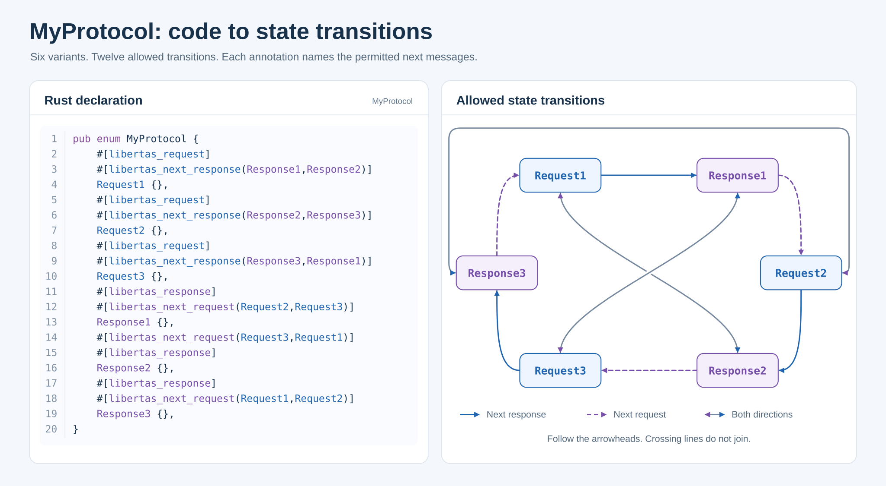

# Endpoint protocols and runtime

This page covers App-visible protocol and lifecycle rules. For exact runtime
function signatures and callback guarantees, read the installed public SDK.
Every declaration must also follow the
[schema documentation invariants](documentation.md).

Unless a block is explicitly labeled a non-copyable schematic, its declarations
are copyable into an App whose package header already has the required natural
label and description. The data-name example includes that package header
because its package-level resource declaration depends on the header.

## Declaring an Endpoint

A server Endpoint is conceptually equivalent to a conventional service endpoint: it is the interface through which an App provides a defined set of capabilities to clients. Its protocol Union declares the requests, responses, and subscription messages that clients can exchange. A client Endpoint binds to a compatible server Endpoint, and Libertas routes those interactions under the applicable access controls.

An Endpoint field references a protocol Union. `EndpointServer` marks the App
as the serving side; absence means client-side use.

```typescript
/**
 * Equipment status settings
 * Describes the equipment and service used to read its current condition.
 */
export interface Configuration {
    /**
     * Monitored equipment
     * The user chooses the equipment whose condition will be reported.
     */
    device: LibertasDevice;

    /**
     * Equipment status service
     * The App provides this service so permitted users can read the selected
     * equipment's current condition.
     * @LibertasEndpointSchema(StatusProtocol)
     * @LibertasEndpointServer
     * @LibertasEndpointBaseObjects("$.device")
     */
    endpoint: LibertasEndpoint;
}
```

```rust
/// Equipment status settings
/// Describes the equipment and service used to read its current condition.
#[derive(LibertasExport, LibertasAvroDecode)]
pub struct Configuration {
    /// Monitored equipment
    /// The user chooses the equipment whose condition will be reported.
    pub device: LibertasDevice,

    /// Equipment status service
    /// The App provides this service so permitted users can read the selected
    /// equipment's current condition.
    #[libertas_endpoint_schema(StatusProtocol)]
    #[libertas_endpoint_server]
    #[libertas_endpoint_base_objects("$.device")]
    pub endpoint: LibertasEndpoint,
}
```

`EndpointBaseObjects` uses comma-delimited Libertas Schema Paths to bind an
endpoint instance to configuration objects.

On a client Endpoint, `Default` and `Fixed` take a
`developer-package::function` task-process identity. Every client first filters
server Endpoints by mutual protocol-schema compatibility. `Default` leaves all
compatible choices available. `Fixed` further restricts choices to servers
owned by the named task process and makes its package a mandatory logical App
dependency in finalized `AppDependencies`. Both Endpoint-ID selectors remain
editable because one process can expose multiple eligible server instances. If
the resulting set is empty, either value identifies the process to provision.
Only `Fixed` forces the package into deployed `AppDependencies`; the client
task pre-creation gate below may nevertheless require installation of the
named task process for an absolutely required Endpoint carrying either
attribute. These strings are not Endpoint IDs or schema-type references.

### Required client task-process dependencies

An App author models only the source contract: a client Endpoint carrying
`Default` or `Fixed` can become a task-creation prerequisite when that
occurrence and its complete path are non-nullable and every ancestor List
requires at least one item. Keep the real optionality and List bounds truthful;
do not add App code or generated metadata to implement provisioning.

Control clients own the traversal, eligibility, installation, queue, cycle,
refresh, cancellation, and Hub-validation behavior. Its single canonical
definition is the
[task pre-creation dependency check](schema.md#62-task-pre-creation-static-dependency-check).

Use the no-argument `@LibertasExcludeUI` or `#[libertas_exclude_ui]` marker on
an Endpoint server carrying a resolved `ProtocolSchema` when Control UI must
act as though that Endpoint does not exist. The Hub Control service omits the
marked server Endpoint from its UI-device list before grouping devices, so it
cannot appear as a root or task child, cannot affect folder cardinality, and
cannot contribute LLM tool definitions. The Endpoint remains registered and
available to routing, subscriptions, authorization, and administration. The
same marker is valid on a `Request` or `SubscriptionRequest` variant reachable
from an Endpoint protocol Union and removes that operation from generated
Control UI and Hub LLM tool-definition generation. Admin creation, editing,
approval, persistence, Endpoint compatibility, and dependency/assignment
calculations continue to use the complete schema rather than the user-facing
projection.

Runtime bindings identify an Endpoint server by its resolved `ProtocolSchema`.
If more than one server Endpoint resolves to the same protocol root, every one
of those Endpoints must use the same `ExcludeUI` value. Studio rejects mixed
visibility because the runtime binding cannot distinguish those Endpoint
declarations.
The exact projected Control surfaces and unaffected behavior are defined by the
[schema attribute contract](schema.md#45-union-endpoint-and-data-attributes).

```typescript
/**
 * Refresh current status
 * The service refreshes equipment status in the background without offering
 * this activity as a user action.
 * @LibertasRequest
 * @LibertasExcludeUI
 */
export interface InternalRefresh { kind: 0; }

/**
 * Background refresh completed
 * Reports when the background refresh finished.
 * @LibertasResponse
 */
export interface InternalRefreshComplete {
    kind: 1;
    /**
     * Completion time
     * The instant when the background refresh completed.
     */
    completed_at: LibertasDateTime;
}

/**
 * Background status activities
 * Describes automatic status refreshes and their completion.
 */
export type StatusProtocol = InternalRefresh | InternalRefreshComplete;

/**
 * Background status settings
 * Describes the service used to keep equipment status current automatically.
 */
export interface Configuration {
    /**
     * Background status service
     * The App provides this service to refresh equipment status without
     * presenting a separate user choice.
     * @LibertasEndpointSchema(StatusProtocol)
     * @LibertasEndpointServer
     * @LibertasExcludeUI
     */
    internalEndpoint: LibertasEndpoint;
}
```

```rust
/// Background status activities
/// Describes activities that keep equipment status current automatically.
#[derive(LibertasExport, LibertasAvroDecode, LibertasAvroEncode)]
pub enum StatusProtocol {
    /// Refresh current status
    /// The service refreshes equipment status in the background without
    /// offering this activity as a user action.
    #[libertas_request]
    #[libertas_exclude_ui]
    InternalRefresh,

    /// Background refresh completed
    /// Reports when the background refresh finished.
    #[libertas_response]
    InternalRefreshComplete {
        /// Completion time
        /// The instant when the background refresh completed.
        completed_at: LibertasDateTime,
    },
}

/// Background status settings
/// Describes the service used to keep equipment status current automatically.
#[derive(LibertasExport, LibertasAvroDecode)]
pub struct Configuration {
    /// Background status service
    /// The App provides this service to refresh equipment status without
    /// presenting a separate user choice.
    #[libertas_endpoint_schema(StatusProtocol)]
    #[libertas_endpoint_server]
    #[libertas_exclude_ui]
    pub internal_endpoint: LibertasEndpoint,
}
```

## Protocol roles

Every message-bearing protocol Union variant must have at least one role:

- `Request`: one-shot request input;
- `Response`: server-to-client correlated result;
- `SubscriptionRequest`: client-to-server stream establishment/renewal; or
- `SubscriptionData`: server-to-client stream data.

<a id="protocol-role-reuse"></a>
<!-- protocol-role-reuse:start -->
A message-bearing Protocol Variant may declare more than one role. Its declared
roles identify its permitted uses; the actual operation and interaction context
determine the applicable behavior. Additional roles do not themselves initiate
operations or combine their effects. Each declaration must satisfy the
constraints applicable to its roles. Operation-selection rules still apply when
choosing which declared use to invoke.

A correlated Response operation requires a `Response` variant, and subscription
delivery requires a `SubscriptionData` variant. `EditRequest` is a correlated
server reply carrying a complete `Request` value: its variant must carry
`Request`, and a Request-only variant suffices. EditRequest is an operation,
not an additional schema role, and receiving it does not invoke the request.

<a id="interaction-reference-object"></a>
<a id="interaction-reference-context"></a>

**Reference context and request construction.** The **current request** is the
value being composed or edited. Workflow and non-workflow requests may need
related server data; a session ID is required only when the App needs one.
A **reference context** is the lookup environment of a request under
construction. It belongs to the received value that the request is built
from: a displayed Response, a delivered EditRequest, or a subscription. Its
contained schema-described values are **reference objects**.

| Context | Reference objects and request construction |
| --- | --- |
| Ordinary Response | CopyFrom probes the latest non-transition acknowledgement received since the displayed Response was installed, when one exists, then the displayed Response. A transitioning Response replaces both. |
| EditRequest | The received complete Request is the reference object. Adopt its data directly without CopyFrom or default initialization. |
| Subscription | The reply that completed the SubscriptionRequest is the first state of the SubscriptionData snapshot and is not kept as a separate object. CopyFrom probes the most recent successful correlated Response received after it, when one exists, then the current snapshot. Either object may be absent. |

Subscription reports, including reduced-type updates, update the SubscriptionData
snapshot without replacing the retained Response. In a subscription, a
successful correlated Response replaces the Response object even when an
acknowledgement leaves the screen unchanged. Over a displayed Response, a
non-transition acknowledgement replaces only the acknowledgement object, and
the displayed Response remains the second object; a transitioning Response
replaces both. In every context, a failure status or Error-marked
Response leaves the reference context unchanged. The two objects of a
context remain separate and are not merged into a synthetic value. The context
of another displayed value, editor, or subscription, and historical responses,
are never searched. With no eligible received data, the
reference context has no objects.

`CopyFrom` names source paths on a receiving request node. It copies
already-received data from the reference context without contacting the server.
For each mapping, probe objects in context order and paths within each object
in declared order under the [shared copy rules](schema.md#shared-copyfrom-and-copyto-rules).
Copied nodes override initialization; unaffected nodes retain ordinary
initialization, including defaults or undefined. Direct EditRequest adoption
preserves all received values and supplies a new context containing that Request.

For example, a non-workflow update can copy `item_id` and `revision` without a
session ID. In a subscription, a Response may supply the new revision while
another CopyFrom mapping reads a value available only in SubscriptionData.
An App must carry forward required continuation data; missing values are not
recovered from older responses.

<a id="hidden-protocol-context"></a>

**Hidden protocol context.** Session identifiers, continuation cookies, record
identifiers/revisions used only for application coordination, and application
data carried only to initialize a later request must be schema-defined `Hidden`
fields in the protocol payload. Apply Hidden to each such field or to its
containing cookie/context field. A visible user-facing value may also be a copy
source; do not hide that value merely because another request copies it.

- The server supplies required context in the Response, complete EditRequest,
  or SubscriptionData snapshot from which the next action is constructed.
  Declare CopyFrom on receiving request nodes that need those values. Keep
  session/coordination fields Hidden in the request too; a field initialized
  for the user to review or edit remains visible. Hidden on the source is
  presentation metadata, not a command to hide the destination of a value copy.
- Hidden data remains typed payload data: it participates in reference reads,
  copying, validation, subscription updates, and encoding. Hiding a field does
  not initialize it or exempt it from completeness checks. Follow the
  [Hidden presentation rule](presentation.md#common-field-metadata).
- Supply required data on every permitted construction path, including initial
  entry, subsequent actions, workflow navigation, and resubscription. A complete
  EditRequest already supplies its hidden values; clients must not initialize
  over them. For copied requests, copied nodes override initialization and
  unaffected nodes follow the shared initialization rules. Never rely on a
  user to fill a hidden missing value or invent a placeholder session ID.
- Design continuation data against the reference-context replacement rules
  above. Carry it forward when its supplying object is replaced; an ordinary
  success acknowledgement can replace the retained Response of a subscription,
  or the previous acknowledgement over a displayed Response, while the screen
  stays unchanged. SubscriptionData or the displayed Response remains the
  second reference object, but an older Response or acknowledgement is not a
  fallback. Error does not replace either
  object. Reduced reports preserve or update hidden fields under the same
  projection rules as visible fields.
- First-time entry has no prior reference objects. Entry requests must be
  constructible from their own valid inputs and normal initialization; the
  server then supplies any continuation context needed for later actions.
  Handle absent external validation reads under the
  [validation contract](validation-rules.md). Do not copy a value into the
  request solely to validate against it when a reference-context read suffices.
- Hidden controls presentation, not confidentiality or authorization. These
  bytes reach the client. The server must validate submitted identifiers,
  revisions, session ownership, and allowed operations; client-side invisibility
  is not evidence of trust. A session identifier is needed only when the App's
  interaction requires one.

For example, a Response may carry a hidden `context` containing `session_id`
and `initial_limit`. A selected Request copies `$.context.session_id` into its
hidden `session_id` and `$.context.initial_limit` into its visible, editable
`daily_limit`. The user sees the limit, while the submitted payload carries both
values. An EditRequest instead supplies both request fields directly. These
are ordinary schema fields and shared CopyFrom paths, not a separate cookie
transport or client-maintained session history.

`ValidationRules`, `RangeMin`, and `RangeMax` use the same reference context for
external reads, retaining their own path syntax and first-non-null rules.
Current-data reads inspect the request being edited. No matching value or an
empty context yields null, which first-time composition must handle. Reading
neither copies values nor fetches server data.

Intermediate calculation CopyFrom probes the bound current editor first,
then the reference objects in the interaction context's order. Within each
source, try the declared paths in order, using the shared copy availability
and valid-null rules. A valid editor match wins; no new source-selector syntax
is needed. Parent-relative paths retain their bound editor ancestry.
These logical contexts need not use separate stored objects:
a received EditRequest may be both the current request and its reference object.
A [link](#links) declared in a request editor constructs its target in the same
order. Results still apply to the bound current-request destination under the
[calculation contract](#field-calculation-requests). PrevRequest construction
retains its current-editor source under the [path context rules](schema.md#context-and-syntax).

<a id="workflowrequest-semi-role"></a>

**WorkflowRequest semi-role.** `WorkflowRequest` specializes `Response` through
a schema attribute. `NextRequest` identifies available next request actions;
`WorkflowRequest` requires the client to construct and open its named request
immediately when the variant is received as a correlated Response. Its variant
must carry `Response`, and its attribute value must name exactly one `Request`
variant in the same protocol Union. It cannot coexist with `NextRequest` or
`Error`.

The client uses the received response under the reference context and request
construction rule above. The response may contain arbitrary valid cookie data or be empty; it is not shown
as an intermediate screen. The resulting editor may be incomplete and awaits
explicit user submission, even for Nil, already complete, or entirely
Fixed/ReadOnly payloads. Normal request visibility and access rules apply; an
unavailable target must not be silently replaced with another request.

For example, a variant carrying both `Response` and `SubscriptionData` can use
`WorkflowRequest` to open its named editor on correlated Response delivery.
Subscription delivery of that same variant updates subscribed data without
opening the editor, under the shared role rule above.
<!-- protocol-role-reuse:end -->

Role-less grouping Unions and single-field Union wrappers organize capabilities
under [endpoint protocol validation](schema.md#61-endpoint-protocol-validation).
Their reachable message-bearing variants carry the roles; the grouping nodes
need not carry a role themselves.

An error result is still a `Response`. Mark it with the no-argument
`@LibertasError` or `#[libertas_error]` in addition to its ordinary response
role. The generated `Error=true` marker lets each client select its own
standard error procedure. It does not define an error payload shape or change
serialization, routing, transitions, or compatibility.

An Error-marked correlated Response is out-of-band of the current protocol
state transition.
Android and iOS consume the correlated response but do not install it as the
current response, use it as transaction context, navigate to it, or visualize
it as data or a chart. They preserve the current interaction and current
response data so the user can always retry. The clients inspect the complete
decoded response in deterministic depth-first response order, including hidden
fields, and show its first non-empty renderable `FormattedText` in a persistent
error dialog. When none is renderable, show a localized generalized error in
the same dialog. Server status errors and failures decoding a correlated reply
use this dialog too. Keep the full message readable, allowing scrolling when
needed, until the user explicitly dismisses it. Dismissal does not submit,
navigate, or discard editor values; the user can correct the request or retry. Therefore put the most
useful user-facing explanation in the first `FormattedText` field; the payload may
still contain any typed diagnostic or retry context required by App code.

Outside a workflow, a normal `Response` is not required to declare
`NextRequest` or `WorkflowRequest`. Omitting both is an intentional non-transition and is common for shared
acknowledgement variants such as `Success` or `Failure`. It does not mean that
every Request in the protocol becomes available. After correlating and
consuming such a response, a client completes the in-flight attempt but keeps
the existing protocol state, its displayed data, and its next-request choices.
Reference context follows the [current reference context rule](#interaction-reference-context);
the acknowledgement is not installed as the displayed protocol value.
A transient request/wait surface may complete,
but no protocol-data destination is added or replaced. The reply to a
master-detail [refresh request](presentation.md#master-detail-panes) is not
such an acknowledgement: it re-installs the leading page it refreshes.

The absence of a next state identifies an ordinary completed result without a
separate attribute marking a result variant. Present its user-facing result
message transiently while retaining the existing interactive state; do not
replace that state with a data screen offering no further actions. This
state-preservation rule does not suppress the result message. It leaves the
separate initial-entry, workflow-completion, chart-presentation, and live
subscription behavior unchanged.

Apply these response rules under the [shared role rule](#protocol-role-reuse).
An Error-marked correlated Response uses the separate standard error procedure
above, regardless of `NextRequest`.

```typescript
/**
 * Recording could not continue
 * Explains why the recorder could not save the latest measurement so the user
 * can correct the problem and retry.
 * @LibertasResponse
 * @LibertasError
 */
export interface Failed {
    kind: 1;

    /**
     * Problem explanation
     * Tells the user why the latest measurement could not be saved.
     * @LibertasReadOnly
     * @LibertasFormattedText
     */
    reason: Uint8Array;
}

/**
 * Measurement saved
 * Confirms when the recorder saved the latest measurement.
 * @LibertasResponse
 */
export interface Saved {
    kind: 0;

    /**
     * Saved at
     * Identifies when the recorder saved the latest measurement.
     */
    savedAt: LibertasDateTime;
}

/**
 * Recording activities
 * Describes saving measurements and reporting a problem that prevents the
 * latest measurement from being saved.
 */
export type RecordingActivity = Saved | Failed;
```

```rust
/// Recording activities
/// Describes saving measurements and reporting a problem that prevents the
/// latest measurement from being saved.
#[derive(LibertasExport, LibertasAvroDecode, LibertasAvroEncode)]
pub enum RecordingActivity {
    /// Measurement saved
    /// Confirms when the recorder saved the latest measurement.
    #[libertas_response]
    Saved {
        /// Saved at
        /// Identifies when the recorder saved the latest measurement.
        saved_at: LibertasDateTime,
    },

    /// Recording could not continue
    /// Explains why the recorder could not save the latest measurement so the
    /// user can correct the problem and retry.
    #[libertas_response]
    #[libertas_error]
    Failed {
        /// Problem explanation
        /// Tells the user why the latest measurement could not be saved.
        #[libertas_read_only]
        #[libertas_formatted_text]
        reason: Vec<u8>,
    },
}
```

The following declarations illustrate the [shared role rule](#protocol-role-reuse)
with a Nil `ReadStatus` and a `Status` payload.

```typescript
/**
 * Check equipment status
 * The user asks whether the selected equipment is available now.
 * @LibertasRequest
 * @LibertasSubscriptionRequest
 * @LibertasAccessPrivilege("Read")
 */
export interface ReadStatus {
    kind: 0;
}

/**
 * Current equipment status
 * Reports whether the selected equipment was available when its condition was
 * checked.
 * @LibertasResponse
 * @LibertasSubscriptionData
 */
export interface Status {
    kind: 1;

    /**
     * Equipment is available
     * True means the equipment can currently be reached; false means the
     * equipment is currently unavailable.
     */
    online: boolean;
}

/**
 * Equipment status activities
 * Describes checking the selected equipment and reporting its current
 * availability.
 */
export type StatusProtocol = ReadStatus | Status;
```

```rust
/// Equipment status activities
/// Describes checking the selected equipment and reporting its current
/// availability.
#[derive(Clone, Debug, PartialEq, LibertasExport, LibertasAvroDecode, LibertasAvroEncode)]
pub enum StatusProtocol {
    /// Check equipment status
    /// The user asks whether the selected equipment is available now.
    #[libertas_request]
    #[libertas_subscription_request]
    #[libertas_access_privilege("Read")]
    ReadStatus,

    /// Current equipment status
    /// Reports whether the selected equipment was available when its condition
    /// was checked.
    #[libertas_response]
    #[libertas_subscription_data]
    Status {
        /// Equipment is available
        /// True means the equipment can currently be reached; false means the
        /// equipment is currently unavailable.
        online: bool,
    },
}
```

TypeScript Unions must have a stable numeric discriminator as the first
property. Use a literal or enum member. Use `@LibertasDiscriminator("field")`
only when automatic detection would be ambiguous.

## Request access

`AccessPrivilege` is an alternative-access bitmap on Request and
SubscriptionRequest variants:

| Source value | Schema value | Meaning |
| --- | ---: | --- |
| `Read` | `1` | A user with endpoint read access may invoke it. |
| `Write` | `2` | A user with endpoint write access may invoke it. |
| `Read,Write` | `3` | Either access level may invoke it. |

Omission also means `Read,Write`. A user with administrator privileges grants
a user endpoint read or write access, and the Hub keeps that grant in its
access control list. Libertas cannot infer semantic mutation. The
developer must mark a mutating operation `Write`; otherwise a read-only user is
allowed to issue it. Clients may hide a disallowed action, but the Hub remains
authoritative.

This is unrelated to task-process `Permissions`, which grant access to platform
resources during task configuration.

## Request and response ordering

<a id="human-task-interaction"></a>

**Scope: human-task interaction.** The ordering, pending-operation, waiting,
and leaving rules of this reference are the embodiment for a person
interacting with a task: a generalized interaction with predefined rules that
every generated client implements uniformly, so that one implementation serves
every App without application-specific code. Software that interacts with a
task, such as another App, a program, or a device integration, is not bound
by them: it may agree with the service on its own rules, for example several
requests in flight or its own time limits, within the endpoint's declared
protocol, its roles, and its access checks.

A Control session is the client's session with the Hub. It carries task
protocol messages and other Hub messages, and the Hub serializes all of its
messages. Within one Control session, the request/response transactions of
task protocols follow the exact order in which their requests were sent. Handle requests and emit and apply
their correlated replies in that order; a later transaction must not overtake
an earlier one. This includes calculation replies, Error responses, and
EditRequest replies. Correlation and stale-operation checks still apply: an
obsolete reply is discarded in its turn, never assigned to a later request.
Timeout, cancellation, and transport failure use the existing operation-lifecycle
rules; a late reply cannot revive a completed or abandoned operation.

The ordering scope is one Control session, not all clients globally.
Unsolicited SubscriptionData/DataReport updates are not correlated reply slots;
they retain their own subscription ownership and sequencing rules.

## Field calculation requests

`@LibertasCalculationRequest("CalculateOrder,CalculateShipping")` and
`#[libertas_calculation_request("CalculateOrder,CalculateShipping")]` declare
which calculations use a field of a protocol Request/SubscriptionRequest as
an input. One field may participate in several calculations and several fields
may participate in one calculation. Names are comma-delimited, case-sensitive,
non-empty, distinct protocol variant native names. The annotation is field-only.

Each target is another ordinary Request with a Table payload in the same
Endpoint protocol Union. Its NextResponse names its correlated Response variants.
A calculation reply is plain or an Error: Studio rejects a calculation whose
NextResponse names a variant that declares NextRequest or WorkflowRequest, or
a variant that does not carry Response, such as a Request-only variant, which
only an EditRequest delivers. An Error variant is
admitted whatever it declares, because an Error assigns nothing and navigates
nowhere.
Every direct input field has CopyFrom under the
[shared source contexts](schema.md#context-and-syntax): calculation inputs may
read the current editor first, then reference objects in the
[interaction context order](#interaction-reference-context). Native
discriminators are transport metadata, not calculation inputs. Neither is a
Fixed field: it is filled by ordinary initialization, never by copying editor
data, so it needs no CopyFrom and is never a dependency. A
`Fixed("current-user")` User field is resolved from the authenticated session
and verified by the Hub on the calculation request under the
[security constraint](schema.md#fixed-current-user-security-constraint) as on
any other request; every other Fixed input takes its declared value.
Only the constructed calculation request must be complete and valid to send;
the parent editor may still contain undefined, unencodable fields.

Every copied input is a calculation dependency. Studio validates current-request
participation in both directions: every participating field is used by
CopyFrom, and every current-request source field used by CopyFrom participates
in the calculation unless it is an invariant source.

<a id="invariant-calculation-inputs"></a>

**Invariant inputs.** A source that nothing can change while the editor is open
may feed a calculation without declaring its `CalculationRequest`:

- a current-request value that is `Hidden`, `Fixed`, or `ReadOnly` on the value
  or an enclosing Table or Union, and that no calculation or [link return](#link-return)
  `CopyTo` writes in that request. Its value then comes only from the editor's
  construction: EditRequest, construction CopyFrom, default initialization, or
  a `Fixed` declaration or session value.
  `ReadOnly` on a List protects its membership and order, not its member
  values, so an undeclared List source also needs its elements protected. A `CopyTo` destination, including
  a [calculated allowed set](#calculated-allowed-sets) and the fields it
  constrains, is not invariant even when hidden or read-only;
- a value in the interaction's [reference context](#interaction-reference-context),
  whose reference objects the editor never changes. Only their replacement
  under that rule is an input change, as described under
  [changes](#changes-resets-and-deferred-calculation).

An invariant current-request input never triggers the calculation. Its value is
read when a declared field triggers it and resolves in that invocation's context, so a
page-level hidden list is available to a per-row calculation invoked by a row
field. Declaring participation on an invariant field is unnecessary, and makes
it an invoking field whose occurrence must bind every input. Every other
current-request source, including every user-editable field, must declare the
calculation. Reference-object candidates follow the same
[interaction context](#interaction-reference-context): a Request variant is
never a reference object, except the complete request that an EditRequest
delivers, which is the reference object of its own editor, and a Response or
SubscriptionData variant is a candidate only when its own NextRequest or WorkflowRequest actually offers the
current request; Studio does not treat an unrelated variant that merely
resolves the same path as a source. A containing Table or List may participate as a whole;
changes below it are changes to that input. Paths support named fields and
zero-based literal array indices, such as `$.items[0].quantity`. Whole-list copies
remain available. Indices denote positions, never persistent row identities.
Every input resolves in each invocation from its applicable source context,
and every declared alternative resolves somewhere. Input selection follows the [shared CopyFrom rules](schema.md#shared-copyfrom-and-copyto-rules).

### Typed ancestor paths and per-item calculations

Calculation mappings use [Libertas Schema Path](schema.md#libertas-schema-path),
including its root-relative, parent-relative, relaxed typed-ancestor and strict variant-rooted selector forms. That
section owns the syntax and ancestor-resolution rules; the following rules
own calculation-instance binding and lifecycle.

The invoking context belongs to the CalculationRequest field occurrence, not
the calculation request's input field or its response. Each transaction captures
one immutable invoking node and its ancestor bindings.
Current-request CopyFrom inputs and CopyTo destinations retain those bindings
for the entire transaction, including after a later input change; a deferred
execution is a new transaction. Reference-object inputs retain their distinct
logical source under the [interaction rule](#interaction-reference-context);
this does not require a separate stored object. Participating
fields which bind the same calculation variant to the same ancestor occurrences share one calculation
instance. Different array items have separate instances; root-relative inputs
can be shared and changes to them invalidate every dependent instance. Do not
coalesce different item instances merely because they name the same variant.

Clients retain the bound ancestor identities while waiting. Resolve output
paths against the original binding, never the currently selected row. Removing
or replacing a bound item invalidates its pending work before a reply can write.
A positional mapping which would now address another item is also invalid; never
retarget it. Surviving item-local bindings follow the
[array-removal rule](#array-removal-and-calculation-scope), rather than treating
an index shift alone as changed item data. Rediscover affected current instances
and defer/reschedule still-needed work using the ordinary calculation rules.
New items acquire their own instances. Reset only the destinations belonging
to affected instances. This adds no wire opcode or persistent row identity
requirement.

Studio validates typed paths in every reachable invoking request occurrence,
including reusable record types and nested arrays. It resolves named types and
each declared ancestor selector symbolically under the [Libertas Schema Path rules](schema.md#typed-ancestors-and-bound-occurrences), then validates suffixes, input coverage, type and
nullability compatibility, Fixed protection, and direct/indirect cycles,
counting the implicit writers of [calculated allowed sets](#calculated-allowed-sets).
Overlapping writers are permitted (the later applied assignment wins); a
calculation instance writing its own array item and an enclosing whole-list
write may both apply.
Runtime checks still enforce actual values, bounds, and stale-instance ownership.

### Array removal and calculation scope

For removal, "outside an item" means outside that item's data subtree, not
later in array order. A calculation is item-local only when all fields actually
copied as inputs and all CopyTo destinations belong to that same item. Include
nested fields and the actual projected fields of reduced copies when determining
this scope; the spelling of a path alone does not establish locality.

Removing an item has these effects:

- Cancel that item's pending and deferred calculations. A reply cannot recreate
  the item or write into the item which now occupies its former index.
- Preserve surviving item-local results and work when their bound nodes and
  copied inputs remain unchanged. Do not reset or recalculate them merely
  because their array indices decreased. A pending typed-ancestor calculation
  may retain its original surviving item binding; a literal positional mapping
  which no longer addresses the original nodes must instead be invalidated.
- Recalculate instances associated with the changed array which involve fields
  outside the individual item, including a shared parent/root rate or an output
  outside the item. This applies even if that external rate's value did not
  change. Reset affected outputs and reschedule through the ordered deferred
  queue's remove-then-append rule.
- Recalculate calculations consuming the array as a whole or a reduced array
  projection. Membership is an input change, including removal of the last
  item, even when no surviving element's individual field value changed.

For example, removing one line preserves another line's `quantity × unit_price`
subtotal when both inputs and the subtotal belong solely to that surviving
line. A line calculation which also copies the order's shared `rate` is
recalculated, as is the order total calculated from the array of subtotals.
Calculations belonging to unrelated arrays are not affected by this rule.

### Reduced record and array copies

Calculation copies use the [shared field projection](schema.md#shared-copyfrom-and-copyto-rules).
The destination type of calculation CopyFrom specifies the projection; no extra
attribute is needed. A calculation input type selects
the fields relevant to the calculation. Unrelated fields can be omitted even when
complete or immutable, including large descriptive name strings that do not
contribute to the result. Omitting these values reduces serialized payload size
and avoids repeatedly transmitting them. A required field remains included
regardless of its size or immutability. Primitive semantic types,
currency, and union branch identities/discriminators must remain compatible.
A union-valued field retains its complete union payload type; record projection
does not reduce its branches, authorize conversion, or filter branches.

Construct the destination under the shared initialization rules. A destination
field absent from the source type is unaffected by the copy and retains ordinary
initialization. By contrast, a matching source field whose value is unfinished
remains unfinished in the projection: do not replace it with a default. An
unfinished required projected field blocks the calculation.
Once the required inputs are complete and the constructed request is valid,
unrelated excluded fields do not block sending, whether complete or unfinished.
Valid null is preserved when permitted. Arrays retain
every element in its original order, including incomplete elements; never filter
or compact them. Changes to projected fields and array membership/order are
inputs; excluded fields are not direct triggers.

CopyTo may apply a reduced record to an existing record, or a reduced array to
an existing array, under that same field projection. An existing destination
field with an unavailable value is not an extra field. Reduced arrays require
the original length and order, use zero-based
positional correspondence, and cannot insert, remove, or reorder elements.
Nested projections follow the same rule. Validate all mapped fields, bounds,
protected destinations, and retained bindings before applying any assignment.
A membership change invalidates a pending whole-array result. This is a merge
into existing data, not permission to create missing parents or replace a union
with an incompatible branch. Full-type assignments retain their existing meaning.

### Applying calculation results

`@LibertasCopyTo("$.orderTotal")` and `#[libertas_copy_to("$.orderTotal")]`
on a successful calculation Response payload field assign that field to one
field of the originating editor. Every direct successful response payload field
has CopyTo; discriminators and Error responses are exempt. The source may be a
whole Table or List. In this calculation context, CopyTo has one root-relative
or typed-ancestor path, including zero-based array indices, and does not replace
the request root. Applying a calculation result does not navigate or replace
any object in the editor's reference context. The [reduced SubscriptionData design
pattern](#reduced-subscriptiondata-design-pattern) uses variant-level CopyTo
lists in a stable subscription context.

Studio checks mappings in each invoking editor, including reusable types,
field types, nullability, numeric semantics and money currency. **A
calculation may perform any assignment that cannot trigger itself.** Apart
from the protected destinations named below, Studio
rejects only direct and indirect calculation cycles: a calculation that reads,
directly or through other calculations, a field it writes. Reading a Table, a
List, or a reduced projection reads its membership and the descendants its
[projection](#reduced-record-and-array-copies) includes, and only those. Writing a
Table/List also writes its descendants, and writing a ConstrainedBy source
counts as writing every field it constrains, because re-filtering can reset
that field ([calculated allowed sets](#calculated-allowed-sets)). Overlapping
destinations are otherwise permitted: distinct calculations, a link return
and a calculation, or assignments within one response may write the same or
nested destinations. Assignments within one response apply in declaration
order; distinct transactions apply in the order their replies are applied
under the [ordering guarantee](#request-and-response-ordering), so the later
assignment wins. The platform guarantees that order and nothing more: the
settled value of a destination that several calculations write follows the
order of the edits that triggered them. Designing calculation requests whose
overlapping results agree is the App developer's responsibility.
ReadOnly prevents user edits, not calculation assignments. Fixed destinations and Fixed descendants
cannot be overwritten (Union discriminators remain transport metadata), nor can
a [CacheIdentity](annotations.md#cacheidentity) field or data containing it,
which stays immutable for the editor's lifetime. Applications own meaningful default values and whether
an editable destination is appropriate for an automatically assigned result.

The client checks the complete mapping before applying it atomically. A null
result assigns null to a nullable destination. An unavailable union branch,
null parent, or out-of-bounds array destination rejects the complete update;
CopyTo never creates missing parents or extends arrays. A rejected update is a
calculation failure: it is reported, it is not sent again automatically, and
Submit stays disabled until a retry settles under the
[failure rule](#changes-resets-and-deferred-calculation). No unrelated field,
default initialization, or navigation is changed by a successful assignment.
An Error response applies no assignments and uses normal error presentation.
A [link return](#link-return) applies these rules to a plain reply to a link
sent from an editor; it may write a calculation's destinations, and the later
assignment wins.

### Changes, resets, and deferred calculation

Editor initialization alone does not trigger calculations. EditRequest values
are supplied by the service. Changes to participating inputs, including results
assigned by another calculation or changed reference context inputs, trigger
their calculations. Adding a List member is such a change for the calculations
of that member's own fields, also when every input has a Default; each is sent
once its inputs are complete. Changes are measured
as typed editor values, including becoming undefined; formatting alone is not
a new input. Invalid intermediate input still invalidates pending work.
Native inline editors may buffer text until Done. Buffered changes invalidate
pending replies immediately and defer sending until the local edit finishes.
Submit requires that edit to finish; an independently valid Prev request, when
offered in the current presentation, remains available to discard it.
While any calculation is pending or deferred, Submit is temporarily disabled;
nothing is queued to send later. The fields stay editable, and an edit starts a
new calculation round that keeps Submit disabled. Submit becomes active again
when the calculations settle, and then validates and sends its snapshot; a
[RequestConfirmation](#request-confirmation) dialog comes after that
validation, and its Send sends the validated snapshot. A calculation failure
shows its error and keeps the editor open. Links, an offered Prev action, and
exit stay available during calculations: leaving the editor discards the
round and its unfinished values. A link chosen while a calculation is pending
constructs its request from the values as displayed, including a calculated
value whose newer result has not arrived. The
[pane contract](presentation.md#master-detail-panes) still suppresses Prev in
an embedded trailing pane.
When a required output is undefined because its calculation cannot run, an
input being incomplete or invalid, reconstruct and validate the calculation
request from its current inputs. Preserve the concrete failure's explanation
and map its field or rule-owning group through the input
[projection](schema.md#shared-copyfrom-and-copyto-rules) to the exact original
current-request occurrence, including List positions, field names and the
selected Union branch. Present that owner under the
[validation result contract](validation-rules.md#18-validation-result).
For example, a List inside an income document that violates `SizeMin` shows
the size error on that List, even when the calculation copies the whole
income-documents collection.

Only when there is no concrete current-request owner to map, such as an
unavailable copy, a reference-context input, an input without a matching source
field, or a function-wide rule, report the blocked calculation on its triggering
field and name the input it needs. Do not infer field blame from a rule
expression. After an accepted edit, recheck the marked input in a freshly
constructed calculation request and clear its marker when that input passes
or its original occurrence is removed or replaced; do not wait for the output
or transfer the marker to another List row or Union branch. A fallback marker
for an unavailable required output remains until that output is usable.

When inputs change, reset all affected output destinations inferred from every
successful NextResponse's CopyTo mappings through ordinary default initialization:
Fixed/Default/localized/type initialization may produce a value, null, or undefined.
Do not rerun CopyFrom for resets or introduce a separate validity rule for a
valid default. Reset and result assignments are atomic editor changes; propagate
them through the acyclic dependency graph before sending dependent requests.

Clients permit continued editing. **An editor has at most one calculation
request in flight**, whatever its calculation and whatever its instance: two
calculation requests are never in flight together, even when they are of
different types or belong to different List items. Every other scheduled
calculation is deferred. A change that schedules the occurrence of the request
in flight makes that request **obsolete**: its reply is discarded in its turn
and assigns nothing. Obsolete work is never queued again on its own account;
the change that made it obsolete has scheduled that occurrence by the ordinary
rule below, in the ordinary order. A change that schedules nothing for that
occurrence leaves the request valid and its reply is applied. Array removal
cancels or preserves item-local work under the
[scope rule](#array-removal-and-calculation-scope).
Deferred calculations form one ordered queue for the editor, with **at most
one entry per calculation type**, a type being one calculation Request
variant. The queue orders the types. An entry records the bound occurrences of
its type that await evaluation, such as the List items whose inputs changed;
array items of one type share that type's entry. Whenever a change schedules a
calculation, add its occurrence to the entry of its type, creating the entry
when absent, and move that entry to the tail. Do not retain its old queue
position or append a duplicate. For example, with the types queued as
`[A, B, C]`, a change that schedules B produces `[A, C, B]`; one that
schedules A next produces `[C, B, A]`. When one change schedules several
types together, their entries move to the tail in the order in which the
changed field's `CalculationRequest` lists them: a field declaring `"A,B"`
leaves A ahead of B. When one atomic editor change alters several fields,
such as the assignments of one reply, the fields are taken in assignment
order and each field's types in its listed order.

The in-flight transaction keeps its immutable invoking context. A new change
queues a deferred execution; it cannot rewrite the transaction already sent,
and it cannot be sent before that transaction's reply has arrived.
Only after the in-flight transaction completes, with its result applied, its
failure reported, or its obsolete reply discarded, is the queue head
reevaluated and, when still valid, sent. Dispatch deferred work from the queue
head in order, one at a time, never by schema declaration order or response
completion speed, and never past a head that cannot be sent yet. Replies are
therefore applied in the order of the queue, which is the order in which
[overlapping assignments](#applying-calculation-results) take effect.
Calculation transactions also obey the
[request/response ordering guarantee](#request-and-response-ordering).

A deferred entry represents work to reevaluate, not a previously encoded
request. At dispatch, take the awaiting occurrences of the head entry in array
order. Reconstruct each from the current input contexts and check validity.
If it is invalid or its invoking context no longer exists, drop that occurrence
without sending; a relevant later input change can schedule valid work again.
Otherwise send it, one request at a time. The entry leaves the queue when its
last occurrence has been sent or dropped; an entry whose every occurrence was
dropped sends nothing. Result and reset assignments which
trigger calculations use the same remove-and-append rule after dependency
propagation. Scheduling never changes the bindings of an in-flight transaction.

A failed calculation, whether a timeout, a transport failure, or a
[rejected update](#applying-calculation-results), is not sent again
automatically: the next edit or Submit runs it again. That Submit sends
nothing; Submit stays disabled until the retry settles and is then pressed
again. Obsolete errors do
not report against a newer edit. Leaving or replacing the editor abandons its
pending/deferred calculations; late replies cannot reopen it or update array
positions that have changed ownership.

Submit and Prev send their own validated, immutable snapshots and own their
navigation. Calculation replies cannot mutate a submitted snapshot. If the
operation fails and the editor remains, reevaluate unfinished calculations.
No partially filled parent request is transmitted. Applications remain
responsible for backend business rules and meaningful defaults; Studio proves
structural declarations, while clients validate actual runtime values.

### Reusing a variant for reading and editing

A variant may carry both `Request` and `Response`. Add `NextRequest` naming that
variant to offer editing after receiving it, and `CopyFrom("$")` on the request
payload to initialize the complete editor from the
[current reference context](#interaction-reference-context). `NextResponse` may name the same variant for the server's updated
result. Root copying copies nested values into an independent editing value;
changing the editor does not mutate the received response.

This supports a receive, edit, submit, and receive cycle using the same data
shape. It does not automatically turn response display into an inline editor.
The existing [protocol navigation rules](endpoint-presentation.md#protocol-transaction-stack)
control presentation under the [shared role rule](#protocol-role-reuse). The
[shared copy rules](schema.md#shared-copyfrom-and-copyto-rules) determine
initialization when no reference context is available.

## Workflow interactions

This is the unreleased workflow interaction contract. A protocol Union may mix
state-machine interactions, whose stable screen is a response or subscription
report, and workflows, whose stable screen is a request editor. The service
selects every resulting transition. There is no separate machine-type marker.

### Valid data and editor state

Every transmitted value must be structurally valid for its Avro schema. An
editor can also contain an undefined field: it has neither a valid value nor
an encoded null. A required undefined field prevents submission. Validation
expressions may observe undefined as null, but this does not change the wire
schema or make the field nullable. No partially filled request is transmitted
for initialization or backend draft persistence. The
[CacheIdentity contract](annotations.md#cacheidentity) defines opt-in local
recovery of committed field values on large workflow pages, independently of
backend persistence. Uncommitted control text is discarded on exit. Without
CacheIdentity, all unfinished page edits are discarded and the application
resumes from its own saved, valid data.

### Entering and continuing a workflow

A resolved editing Request can identify its leading-page row through an [enum/protocol association](schema.md#enumeration-protocol-associations), including direct entry; see [master-detail panes](presentation.md#master-detail-panes).

The server has two ways to open the next editor:

- **EditRequest:** a server-to-client opcode carrying one complete, structurally
  valid Request variant from the Endpoint protocol Union. It is a correlated
  reply to the pending Start, Submit, Prev, or Resume request and completes that
  operation under the [shared role rule](#protocol-role-reuse). The client uses
  the supplied value directly, without running CopyFrom or default
  initialization over it.
- **WorkflowRequest:** applies the [Response semi-role](#workflowrequest-semi-role).
  `@LibertasWorkflowRequest("EditProfile")`
  and `#[libertas_workflow_request("EditProfile")]` emit
  `WorkflowRequest=EditProfile`.

EditRequest also awaits explicit user submission, including Nil, already complete,
or entirely Fixed/ReadOnly values; it must not automatically resubmit them.
Its reference context follows the [current reference context rule](#interaction-reference-context).
EditRequest replaces the active editor even when the returned variant
is the same variant as the previous step; variant identity is not step identity.

When a delivered editor, whether the target of a WorkflowRequest or the variant
of an EditRequest, is beyond the user's [AccessPrivilege](#request-access), the
client refuses the reply by the error procedure and keeps the originating
surface, its reference context, and its draft. `ExcludeUI` and
[`LinkOnly`](#link-only) govern what a client offers, not what the service
delivers: a delivered editor that carries either is installed.

On Request/SubscriptionRequest variants, NextResponse may list Response,
SubscriptionData, or Request variants. On SubscriptionData it instead declares
[directional compatible updates](#compatible-subscriptiondata). Permitted
delivery follows the [shared role rule](#protocol-role-reuse).
When NextResponse is declared,
a successful transition reply must be one of its named variants. Error responses
and standardized failure statuses use the shared error/retry path and do not
need to appear in this navigation list. These declarations constrain the
possible replies; the client never selects the service's reply for it.
A reply that the client refuses before it takes effect is handled as a
failure: the client reports the refusal by the error procedure, and the
originating surface, its reference context, its actions, and its draft stay.
The client refuses a correlated reply that cannot be decoded, whose variant the
request's NextResponse does not admit, or whose variant carries only
SubscriptionData; an EditRequest value that is not a valid value of its Request
variant; a delivered editor beyond the user's access, as above; a
[link return](#link-return) that cannot be applied; and a reply whose
[allowed-action list](#response-action-constraints) is malformed.

### Submit, previous actions, and completion

The workflow's **Next/Submit** button validates and sends the current request.
It is not a chooser for the state machine's NextRequest actions.
These are control roles: a page's Display Template may supply localized
[button captions](presentation.md#button-labels) without changing their
behavior, eligibility, or request names inside a chooser.

`@LibertasPrevRequest("ReopenProfile,ReopenAddress")` and
`#[libertas_prev_request("ReopenProfile,ReopenAddress")]` belong on a Request
variant and emit `PrevRequest` containing one or more distinct Request variant
native names in the same protocol Union. Their declared order is presentation
order. With one eligible target, Back selects it directly; with several, Back
opens a chooser using their ordinary localized names. This is the workflow's
in-app **Go Back** action, distinct from screen-navigation and system Back.
With none, there is no workflow Back action.

While the editor is embedded in a master-detail trailing pane, clients
suppress all workflow Back controls, including the chooser and shortcuts,
under the [pane contract](presentation.md#master-detail-panes). The pane offers
Close and Next; the leading pane owns navigation for the two-panel arrangement,
and the App must make that navigation complete.
A [transient request composer](endpoint-presentation.md#protocol-transaction-stack)
likewise never offers a workflow Back control: it was opened above a displayed
page by the person's own choice, and its Cancel already closes it while idle.
The declaration remains available for ordinary full-page workflow presentation.
Suppression depends on the editor's actual placement, never on inferred
equivalence between requests.

A request whose purpose is to choose where to go, such as a section chooser
offered as a "Go to" action, belongs in a composer above the page it leaves.
There is no reason to deliver it as a workflow editor through WorkflowRequest
or EditRequest: such a page would exist only to be left, and the service
already opens the chosen destination as the reply to the composed request.

`PrevRequest` names this action declaration, not a stored previous request or
reference context. Its declared target list is not dynamically filtered by
`ConstrainedBy`.

Each selected Back action constructs an ordinary request using the
[shared CopyFrom rules](schema.md#shared-copyfrom-and-copyto-rules). Its reference
object is the current editor's selected payload, independently of
the unfinished editor's validity. A hidden application-defined cookie can
identify any of several concurrent workflows. Cookie design and historical selection belong to the application. Accepting
a historical edit must follow the [saved-page consistency rule](#saved-page-consistency-after-historical-edits). Studio validates declarations and statically decidable mapping
rules; it does not prove that cookie fields are initialized on every path.
The client refuses to encode or send an incomplete or invalid previous action.
Only the newly constructed action request is encoded; the current draft is not.

Back expresses abandonment of the current edit. The backend decides what to
return, including a complete historical request through EditRequest. The client
does not navigate through cached historical requests. Construct and validate
the action before sending it; a rejected selection or failed attempt follows
the ordinary error/retry procedure. There is no server-side undo implied by
discarding the current edit.

For a workflow Submit or Prev operation, a non-error response without
WorkflowRequest ends the editor and is presented as the resulting stable
response. NextRequest, if present, offers its declared state-machine actions.
With no NextRequest, the response is a valid terminal screen, for example a
FormattedText congratulations message. The state-machine acknowledgement rule
for ordinary requests outside a workflow remains unchanged.

Only the explicit workflow Prev and Next/Submit buttons have workflow semantics.
Native Back, dismissal, or leaving the interaction sends no previous action.
Local draft retention follows [CacheIdentity](annotations.md#cacheidentity);
Control endpoint navigation follows
[the landing rule](#control-endpoint-landing-and-native-back). Closing a field picker or nested
editor returns to the same parent editor. Cancelling an action chooser changes
neither data nor workflow state.

### Saved-page consistency after historical edits

Later pages can depend on earlier accepted answers, so a workflow service keeps
its stored pages consistent with one another when an earlier page changes.

Compare the submitted page answers with the saved answers before changing any
stored page. Ignore transport cookies, navigation metadata, and
presentation-only values in this comparison. An unchanged Next is
review/navigation: preserve all saved pages and completion state. Opening,
canceling, or rejecting an edit also preserves saved history.

When the backend accepts a changed page, it **must**, for each stored page that
the changed answers affect, do one of the following: recompute and revalidate
that page's data against the revised answers and save the consistent result;
erase that page's data; or keep the page's answers and mark the page
unanswered, so that it is asked again, with those answers, before the workflow
can complete. This is a mandatory application rule, not an optional client
navigation policy. Do not erase before validation or leave a partially updated
state visible. No page remains answered for resume, calculation, or completion
merely because it was valid before the change; derived results, cookies,
allowed-choice sets, and saved progress must agree with the revised answers as
well.

Complete this reconciliation before continuing or resuming the workflow. Resume
and EditRequest use only the consistent stored state; retries, concurrent
editors, and late submissions must not restore data from before the change.
The backend owns persistence and consistency; the client and Studio cannot
infer application dependencies or repair saved pages.

Opening a historical editor does not itself change anything. An abandoned or
rejected draft changes no saved history; the rule applies when the backend
accepts and saves the change. For example, changing a saved filing status from
joint to single erases the spouse data that no page of a single filer owns, and
asks again each affected page whose stored answers no longer validate, before
the interview can complete.

### Validation context and progress

Editable requests use the [shared path contract](schema.md#context-and-syntax).
Supported references use the [current reference context](#interaction-reference-context),
including on inherited types and hidden fields. CopyFrom remains separate
initialization metadata with its defined invocation source. EditRequest context
follows that same owner; it does not retain an older response in its place.

Progress is an ordinary FormattedText field following the
[static read-only placement and request-value contract](presentation.md#static-read-only-placement-and-request-values).
For example, the service can supply it in EditRequest or response data copied
into a WorkflowRequest editor. There is no progress opcode, percentage schema,
fixed step count, or client inference from previous-action lists or history.

### Operation ownership

EditRequest uses the same correlation, status envelope, transport failures,
and error/retry procedures as an ordinary reply. Allow only one pending Submit,
Prev, or [link](#links) transition per editor; while one is pending, the others
are blocked. Until its reply arrives, the editor accepts no edit, link,
document import, or second transition, so a link return never arrives after
the user edited its destination. A displayed value likewise has at most one
pending operation: a second action or link is blocked until the reply.
A duplicate or late reply cannot replace an
editor after its operation was consumed, its editor superseded, or the
interaction exited. Subscription updates and auxiliary calculation responses
keep their own owners and cannot perform workflow navigation or overwrite a
replacement editor. Leaving the UI cannot retract a submission already received
by the backend. Persistence, retry idempotency, and resume selection belong to
the application; the client never serializes an incomplete draft to supply them.

<a id="exit-while-pending"></a>

**Leaving while an operation is pending.** For
[human-task interaction](#human-task-interaction), protocol interaction is strictly
ordered and proceeds request by request: every Request has its correlated
reply, and only SubscriptionData arrives outside that order. A pending Request
is therefore never abandoned on its own. A surface whose operation awaits its
reply cannot be dismissed by itself: not a transient composer, and not an
editor with a sent Submit, Prev, or link. For a person, every sent Request
waits for its reply: a client offers no control that gives up one pending
Request and stays in the endpoint. On a waiting surface, Back, close, and
Cancel leave the endpoint; they never return to the surface beneath, to a
landing, or to another pane.

Leaving an endpoint is part of normal interaction. A person may leave at any
time, whether or not a reply is outstanding, and a task with several endpoints
follows the same rule as a task with one. The Control session continues
unless its transport breaks or times out. Every connection is a new
connection: when the session is lost, the data of every endpoint in it is
cleared, including surfaces, reference contexts, snapshots, and pending
operations and calculations, and after reconnecting an endpoint starts again
from its entry request when the person opens it again. In mobile Control, connection loss returns
to the task's endpoint list when that root remains a list. If the task root
automatically enters a landing, including a task with one endpoint, the client
exits the task to its parent Control screen. Reconnection does not reopen that
task or endpoint; a retained endpoint list may reload its inline default
subscriptions. Every attempt to open a task or an endpoint from its task root
first checks that task's Hub connection. If it is unavailable, the client
reports an error and stays on the current screen. An endpoint protocol Error
preserves the current screen and displays the error. Leaving abandons the endpoint's
surfaces with their pending operations and calculations and queues the
release of its explicit subscriptions; a reply that arrives afterwards is
discarded, and nothing the backend already received is retracted. Entering
the endpoint again repeats its
[entry](#default-request-entry-and-dynamic-actions) request, and
[CacheIdentity](annotations.md#cacheidentity) governs any draft recovery.
Keeping the exchange consistent for a person across leaving and entering
again is the App developer's responsibility: the service admits the entry
request in every state in which the endpoint can be left.

**Waiting is the initiator's decision.** The protocol defines no timeout. The
initiator of a Request decides how long to wait for its reply: a program or an
AI participant applies its own limit, and a person dismisses when they choose
to. Giving up is leaving the endpoint as above; it never produces a reply of
its own and never moves the exchange to another state. A client that initiates
auxiliary requests itself, such as field calculations or a document
transformation, is their initiator and may bound them; an expired auxiliary
request is a failed one and changes no data.

## Chaining, caching, and copied values

Use variant native names, not type aliases or localized labels:

| TypeScript | Rust | Meaning |
| --- | --- | --- |
| `@LibertasNextRequest("A,B")` | `#[libertas_next_request("A,B")]` | Allowed next client variants. |
| `@LibertasNextResponse("A,B")` | `#[libertas_next_response("A,B")]` | Allowed replies on requests; directional compatible updates on SubscriptionData. |
| `@LibertasCopyFrom("$.value,$.legacy.value")` | `#[libertas_copy_from("$.value,$.legacy.value")]` | Populate request data using the [shared copy rules](schema.md#shared-copyfrom-and-copyto-rules) and [reference context](schema.md#context-and-syntax). |

`NextRequest` is optional on a Response. When present, its value must be
non-empty and names the choices installed with that response. With neither
NextRequest nor WorkflowRequest outside a workflow, the response is the
non-transition acknowledgement defined under
[Protocol roles](#protocol-roles); absence is never expanded to every Request
in the protocol Union.

The following non-copyable schematic uses a compact Rust enum to illustrate
the transition annotations. Each Request names two possible Responses, and
each Response names two allowed next Requests.

[](../assets/diagrams/my-protocol-state-transitions.svg)

*Each state appears once. Double-headed links allow both directions;
crossing lines do not join.*
[Open the full-size SVG](../assets/diagrams/my-protocol-state-transitions.svg)
or [download the PNG](../assets/diagrams/my-protocol-state-transitions-six-states.png).

The [shared copy rules](schema.md#shared-copyfrom-and-copyto-rules) define path
selection, initialization, and field projection. The [context table](schema.md#context-and-syntax)
identifies the reference context for each operation, including workflow Back and
calculation construction. Copying from the current editor does not replace the
interaction's [reference context](#interaction-reference-context).

## Protocol conformance

### Protocols describe capabilities

A protocol is a declaration of capabilities: the operations and message payloads
that a participant can send, receive, or support. Client/server matching
establishes which of those capabilities correspond and whether mandatory
requirements are satisfied. Serialization then carries a value for the matched
capability. Protocol translation should be understood in that order, not as
arbitrary substitution of bytes or conversion of unrelated data structures.

A protocol path prefix identifies a payload capability through its enclosing
protocol Union variants. It is not a path to every field inside that payload.
Once the capability is selected, ordinary serialization/deserialization handles
the payload under its compatible schema. Capability correspondence and encoding
are separate concerns; finding a matching prefix does not make incompatible
payload definitions compatible.

<a id="capability-prefixes"></a>

### Capability prefixes across nesting depths

A capability may sit at a different Union depth in each peer. Its prefix is the
chain of protocol variants from the protocol root to the variant that carries a
role; that variant is the capability, and a Union inside its payload is ordinary
payload data, not a further capability. A variant without a role extends the
prefix when it is itself a Union or holds exactly one field whose type is a
Union; a chain of such variants that returns to itself without a role is
invalid. Matching follows a partial prefix while a supported complete path
remains possible, and an unsupported path is rejected.

Correspondence must be unique. A capability's identity is the materialized
Union that owns it together with the role-bearing variant of that Union, so
aliases and enclosing wrappers do not change it. Each endpoint protocol exposes
at most one occurrence of an identity: duplicate occurrences, such as
Primary / OnOff and Backup / OnOff exposing the same OnOff identity, reject the
match before connection, even when their enclosing paths differ. The matcher
never chooses the first occurrence. Distinct identities that share a short name
are not duplicates, and conformance is evaluated in the corresponding
capability context, not by requiring identical outer grouping.

Every prefix element without a role is a Union, or a record whose only field is
a Union, so its Avro encoding is that Union's discriminator alone. A message is
therefore its prefix's discriminators followed by the capability's payload. The
client task host builds a translation plan in both directions, using the server
schema as the wire representation. It translates a message by reading the
sender's discriminators up to the capability, writing the receiver's
discriminators for the corresponding capability, and copying the payload bytes
unchanged. For example, client Manual / OnOff / SetState corresponds to server
OnOff / SetState: the client's three discriminators become the server's two,
and the Boolean payload passes through.

Integers in a payload that name protocol choices, a response's
[allowed-action list](#response-action-constraints) and
[named action-control](#named-action-controls) lists, always name
discriminants of the server schema, the wire representation. The translator
copies them unchanged with the payload, and a client App reads them against
the server's schema, never its own arrangement.

### Required and optional capabilities

Protocol declaration and optional runtime support solve different problems.
The protocol Union itself has one versionless, lifetime-invariant name. New App
versions append new protocol payload variants to that same Union; they do not
replace it with a `V2` Union. The complete evolution contract is in the
[App data-type design guidelines](data-type-evolution.md).

`ProtocolConformance` may be declared on a protocol Union on either client or
server. During task configuration, the client expression is evaluated against
the server declaration and the server expression is evaluated against the
client declaration; both must pass. Operators are:

- `&` AND;
- `|` OR;
- `!` NOT; and
- `^` XOR.

Without an expression, every direct variant in that Union context is mandatory.

Matching variants must also have pass-through-compatible payloads. Libertas
translates only the [capability prefix](#capability-prefixes); inside a
payload, positional fields and overlapping nested Union slots must remain
aligned, and nested optional variants may only extend the tail of a smaller
Union. Payload bytes are not decoded by the translator; the receiving
server or client App decoder validates them against its own schema.

The following focused snippets are non-copyable schematics: the referenced
variants and their required natural-language documentation are omitted so the
placement of `ProtocolConformance` remains visible. A generated App must use the
complete declaration style shown in the preceding role example.

```typescript
/**
 * Equipment status activities
 * Describes checking current equipment, changing its target, and reporting its
 * current condition.
 * @LibertasProtocolConformance("ReadStatus & Status")
 */
export type StatusProtocol = ReadStatus | SetTarget | Status;
```

```rust
/// Equipment status activities
/// Describes checking current equipment, changing its target, and reporting its
/// current condition.
#[derive(LibertasExport, LibertasAvroDecode, LibertasAvroEncode)]
#[libertas_protocol_conformance("ReadStatus & Status")]
pub enum StatusProtocol {
    // Fully documented variants are omitted from this non-copyable schematic.
}
```

If a direct variant's payload is itself a Union, the conformance attribute may
be placed on that variant. That nested expression becomes the variant's
evaluation. Libertas cannot infer that an arbitrary Union is protocol-related,
so append-only protocol policy is a publishing/tooling contract rather than a
universal Union validator.

Configuration matching proves only mandatory compatibility. The server does
not know the client's complete declaration. A client that wants to use an
optional server payload must check the configured server's runtime variant
index before sending the request. In Rust use `VariantIndex` and
`variant_index!`; a nested optional payload may require a chain of variant-index
checks.

No attribute enables protocol Request/Response or subscription-payload caching.
`CacheIdentity` concerns local editor drafts only.

## Compatible SubscriptionData

A SubscriptionData variant A may declare `NextResponse(B,C)` naming other
SubscriptionData variants in the same protocol. A and these named variants form
A's **Compatible SubscriptionData** group. Compatibility is directional: B and C
may update an existing A working value; this declaration does not authorize A
updates to B, B updates to C, or transitive membership.

Every member must have a non-null Table (struct) payload. On an incoming compatible
SubscriptionData report, retain A as the working type and screen, including its
presentation attributes and NextRequest actions. A report with explicit CopyTo
uses the [reduced subscription design pattern](#reduced-subscriptiondata-design-pattern).
For the name-matched form without CopyTo, match fields by exact native
name at the struct root. Replace each matching field's complete value; do not
recursively patch nested records or merge array elements. Preserve fields present
only in A and ignore fields present only in the incoming report. Valid null is a
value and clears a matching nullable field; undefined is never transmitted.
Hidden fields participate in this merge like visible fields.

Studio validates the declaration, Table payloads, and assignability of matching
fields, including numeric/semantic types, nullability, and nested shapes. Clients
prepare and validate the complete merged value before publishing it atomically;
an invalid update leaves the working value unchanged. The App must ensure that
its updates preserve the complete working value's constraints and meaning.

Every incoming SubscriptionData report is offered to every live screen for its
source Hub, including covered screens. Each independently decides whether it
needs the report. Acceptance or rejection by one screen never stops traversal.
Compatibility changes data application, never ownership: Hub, task, endpoint,
schema context, subscription lifetime, and stale-message checks still apply.
A current A may accept its explicitly named compatible reports even when the
original SubscriptionRequest names only A. Before any working value exists,
initial data must satisfy the SubscriptionRequest's NextResponse. If it names A,
B arriving before A is discarded, never deferred or replayed after A arrives.
Process reports in arrival order; schema-loading buffers cannot reorder them. Ordinary
non-compatible reports retain existing acceptance and replacement semantics.
For actions originating from that subscription screen, the merged A supplies
the SubscriptionData object in the [reference context](#interaction-reference-context),
which also retains the latest successful correlated Response received in that
subscription. A report does not replace the Response object or the context of
another subscription or displayed value. A compatible update does not
navigate, submit a request, or execute the incoming variant's actions.
Its delivery scope follows the [shared role rule](#protocol-role-reuse).

Sending compatible reports is entirely the App's choice and responsibility.
Declaring compatibility never instructs the Hub or clients to generate, request,
or synthesize such reports. Apps may continue sending complete snapshots only.
Every SubscriptionRequest, including a repeated default subscription, must return
the current complete initial snapshot. The App owns snapshot/update ordering and
must not rely on a new subscriber having seen earlier reports.

### SubscriptionData array append

#### Relationship to compatible SubscriptionData

This extends the [compatible SubscriptionData contract](#compatible-subscriptiondata).
Existing directional acceptance, all-live-screen delivery, ownership, ordering,
initial snapshot, and atomic publication rules continue to apply. AppendTo does
not grant permission to deliver a report to a screen. A compatible append report
arriving before its required initial snapshot is discarded, never replayed later.

#### Attribute declarations

- `AppendTo("Entries.entries")` is declared on an incoming SubscriptionData's
  root array field. Its value is exactly one `Variant.field` destination, using
  native names in the same protocol. The named variant is a working
  SubscriptionData that admits this report through NextResponse. Its named
  field must be a root array. Nested paths and per-item targets are out of scope.
- Optional `AppendIndex("$.start_index")` is declared on that same array field
  and requires AppendTo. Its root-field Libertas Schema Path references one
  field in the incoming report. That field must be a non-nullable integer Number, carrying the expected
  destination length before the append. Its value must be non-negative.
  The index field should be Hidden; visibility has no effect on validation.
- Both source and destination arrays must be non-nullable. Elements may be
  nullable where assignment to the destination element type permits it.
  Element types must satisfy the existing compatible-field assignability rules.

Use `@LibertasAppendTo("Entries.entries")` and optional
`@LibertasAppendIndex("$.start_index")` on the incoming array in TypeScript.
Rust uses `#[libertas_append_to("Entries.entries")]` and optional
`#[libertas_append_index("$.start_index")]` on that field. The index is an
ordinary integer, not a date, duration, money amount, enumeration index, or
bitmask.

Schematic schema notation:

```text
Entries: Response, SubscriptionData, NextResponse("MoreEntries")
    entries: Array<Entry>
    cursor: String

MoreEntries: SubscriptionData
    added_entries: Array<Entry>
        AppendTo("Entries.entries")
        AppendIndex("$.start_index")
    start_index: Integer, Hidden
    cursor: String
```

#### Applying a report

1. Qualify the report for the current working SubscriptionData using its existing
   directional compatibility and ownership checks.
2. For each append targeting that working variant, compare the optional index
   against the destination array's exact current length, before applying any
   changes from the report. A zero-based append position of zero therefore
   requires an empty destination. Perform this check even for an empty append.
3. Append the incoming elements in their supplied order. An empty array changes
   no elements; duplicates are retained. Without AppendIndex, append without
   the position check.
4. Exclude AppendIndex control fields from copied data. Without variant-level
   CopyTo, apply ordinary compatible root-field replacement to other unannotated
   fields; with CopyTo, apply its typed reduced projection.
   A field carrying AppendTo never also participates in name-based replacement,
   even if its name matches a destination field. If its AppendTo names another
   working variant, ignore that field for this screen; do not fall back to
   ordinary replacement.
5. Validate the complete resulting working value, then publish the report's
   changes atomically. Retain the working type, screen, and actions.

A negative or mismatched index rejects the entire report, preserves the original
working value, and reports a protocol error. Never pad, truncate, overwrite,
adjust an index, partially apply other fields, or infer automatic recovery.
Other assignment or resulting-value validation failures also reject the entire
report. A full snapshot continues to replace its arrays normally.

#### Studio validation and App responsibilities

Studio validates attribute placement, destination and index references, array
and element types, and index integer type. For each possible working variant,
reject conflicting writers: two appends to the same root array, or an append
and an ordinary replacement or CopyTo write to that array within one report.
Actual index values and current array lengths are runtime checks.

The App owns ordering, duplicate-report prevention, retention, and complete
initial snapshots for new subscriptions. If one append report serves multiple
working screens, the App must ensure each intended recipient has the required
array prefix. Under the ordered-delivery contract, an index mismatch exposes a
breach of that expected append sequence. Matching lengths do not prove equal
contents; AppendIndex is a position-consistency check, not a content checksum.

#### Combined copy and append

A report may combine variant-level CopyTo with AppendTo. Each admitted recipient
must still resolve exactly one CopyTo destination; multiple matches are an App
design flaw even when append destinations are unambiguous. Exclude AppendTo
fields and their AppendIndex control fields from that projection. Its remaining
fields follow the typed reduced-copy rules. Resolve all destinations and check
indices before applying the report to one candidate working value. Any copy,
append, index, or resulting-value failure rejects the whole recipient update.

Compute conflicting writes from the actual projection, including descendants
replaced by complete values. Selecting a Table does not itself write omitted
fields retained there. Two appends, or an append and a copied write, must not
modify the same array or its contents. Appended elements must be complete values,
not reduced projections of existing elements.

#### Live chart use

Append reports can supply live chart data. A chart
starts with its complete subscription snapshot; accepted atomic appends extend
the chart-bearing working array and refresh its presentation. Optional
AppendIndex checks the expected sample count. Rejection leaves data unchanged.
Ordering, retention, and fresh-subscriber snapshots remain App responsibilities.
Sending only new elements and update metadata reduces update-message size
compared with retransmitting the complete accumulated array; initial snapshots
remain complete. This is a use of the shared SubscriptionData mechanism, not a separate chart
patch format or an automatic scrolling requirement.

### Reduced SubscriptionData design pattern

**Reduced SubscriptionData** is an optional design pattern an App can adopt
using Libertas subscriptions, `NextResponse`, `CopyTo`, and typed copying. It
introduces no new protocol message role or schema attribute. An App may instead
publish complete snapshots for every update.

An App adopting this pattern maintains a complete stable SubscriptionData value.
Each stable Protocol Variant declares `NextResponse` naming the reduced Protocol
Variants it accepts. Each reduced Protocol Variant declares `CopyTo` with one
or more comma-delimited Libertas Schema Paths identifying the stable values or
subtrees it updates.

The pattern also reuses source-code field identifiers as a shared semantic
vocabulary. An App can give a Native Name one consistent documented meaning
across full state, partial requests, and reduced reports. Compatible types and
explicit paths establish valid field correspondence and select the intended
occurrences; the same identifier can appear in several structures. The App
authors these semantic relationships. See [static and runtime validation](schema.md#9-static-and-runtime-validation)
for the shared checks on declarations and the separate validation of values.

#### Acceptance and destination are separate

The SubscriptionRequest's `NextResponse` selects its complete initial snapshot.
The stable SubscriptionData's `NextResponse` admits later reduced reports.
The reduced SubscriptionData's `CopyTo` specifies where its payload is copied.
CopyTo does not grant delivery permission or infer an acceptance relationship.
A reduced report must satisfy both the existing subscription/ownership checks
and the stable variant's explicit acceptance declaration.

CopyTo is one positional string containing a non-empty path list. For example:

```text
ZoneState: Response, SubscriptionData, NextResponse(NoWaterPeriodsChanged)
ZoneSettings: Response, SubscriptionData, NextResponse(NoWaterPeriodsChanged)
NoWaterPeriodsChanged: SubscriptionData
    CopyTo("^<ZoneState>,^<ZoneSettings>")
```

The example is schematic. The named Protocol Variants belong to the same
protocol; their complete Table definitions and user documentation are required
in an App. A path may instead descend explicitly from the stable variant, such
as `^<ZoneState.schedule>`, when the reduced payload targets that subtree.
Use strict variant-rooted paths to identify the entire destination occurrence;
intermediate schema nodes must not be skipped.

#### Per-destination resolution and typed copying

Resolve CopyTo against each eligible **stable working value** under the
[shared mapping and destination-uniqueness rules](schema.md#shared-copyfrom-and-copyto-rules).
One publication may reach both a ZoneState screen and a ZoneSettings screen;
each independently resolves one destination while retaining its type and actions.
Each recipient retains its own Endpoint, schema, subscription identity/parameters,
and lifetime. There is no global atomic transaction across different recipients.

Schema compilation checks each declared report/destination pair: the stable
variant admits the report, every path names an unambiguous reachable destination,
and source-to-destination type copying is valid. No match does not authorize
name-based fallback.

A field carrying a complete array with the destination's element type replaces
that whole array, including removals and an empty array. This differs from a
reduced-element array projection, which retains the correspondence required by
its copy contract. CopyTo does not imply AppendTo, insertion, or arbitrary
recursive JSON patch semantics.

Prepare and validate the complete resulting working value before publishing
any assignments. An invalid applicable path, stale binding, incompatible value,
or violation of schema-expressible value constraints rejects that working
value's update atomically.
Unrelated fields, the stable Protocol Variant, presentation, and actions remain
unchanged. The reduced Protocol Variant carries CopyTo for its whole payload;
the selected destination type determines the checked field projection.

#### Snapshot, mutation, and publication consistency

Every SubscriptionRequest, including repeated subscription and resubscription,
receives a fresh complete current stable snapshot. A reduced report arriving
before its required baseline is discarded, not saved for later replay. Snapshot
capture and the transition to subsequent reports must not lose a committed
change or reorder publication. Renew the baseline through a subscription request
when the object, filter, or subscription context changes.

A partial-update Request changes authoritative App state after validation and
recomputes affected derived values. Its correlated Response acknowledges that
request; subscription publication is a separate operation. Use an ordinary
non-transition success acknowledgement when the working screen should remain,
and Error for a rejected request. A rejection must not publish the proposed
values as accepted state.

The App is responsible for designing its protocol and transactions to preserve
data consistency across every permitted interaction and state-transition path.
This includes partial/full requests, concurrent clients, devices, timers,
background work, restored state, subscriptions, and restart recovery. The App
coordinates authoritative state changes, affected derived or hidden values,
and publication order; fields that must change together belong in one atomic
report, or the protocol must explicitly coordinate their transition.
NextResponse and CopyTo describe acceptance and typed placement. Schema and
runtime checks enforce their declared structural constraints, but do not prove
application-level consistency across all paths or supply missing transaction
logic. For the same committed state and subscription context, the ordered
reports must produce the complete working value that a fresh snapshot would
describe. App verification must cover the snapshot boundary, concurrent changes,
rejected requests, other mutation paths, changed subscription contexts, and
restart/resubscription. The Hub routes reports without retaining their payloads
or merging them.

## Default and explicit subscriptions

If a protocol declares multiple SubscriptionRequest variants with effective
Nil payloads, only the first one in Union declaration order is the automatic
default subscription. Declaration order therefore matters.

Other subscriptions, including later Nil variants and every argument-bearing
variant, require explicit invocation. The Hub does not retain default-subscription payloads or merge compatible
reports. Each Control tracking admission or reconnect obtains a fresh initial
snapshot from the App through the default SubscriptionRequest. The default may
share one underlying stream, but each user is independently checked against that variant's
`AccessPrivilege` before receiving current or subsequent data. A privileged
user cannot authorize another user's subscription. Apps must not infer peer
identity from how that stream is shared.

For native-client screen lifetime and endpoint-wide explicit release behavior,
see [endpoint presentation](endpoint-presentation.md#protocol-transaction-stack).

The server starts/renews its application stream state only after receiving the
current SubscriptionRequest callback. Host or App restart does not authorize a
server to emit data from remembered application state without a fresh routed
subscription callback.

## Endpoint runtime rules

The public SDK provides operations to:

- register an Endpoint callback;
- send Request or SubscriptionRequest data;
- send a correlated Response;
- publish SubscriptionData; and
- publish the standardized `PeerAlive` signal.

Follow these invariants:

- Branch on the callback action before decoding `data`. `PeerUp`, `PeerDown`,
  `PeerAlive`, and `PeerTimeout` are signals and carry no application payload.
- A server-side peer value is opaque. Retain it and pass it back unchanged.
  Never interpret it as an App, task, user, endpoint, session, or object ID.
- Return the exact nonzero transaction ID and peer supplied with a Request when
  sending its Response.
- Complete an accepted SubscriptionRequest with a correlated Response carrying
  the complete current snapshot, echoing its transaction ID and peer. A
  complete snapshot is therefore always a `Response`. When the same variant
  also delivers later complete reports, declare both `Response` and
  `SubscriptionData` on it. A variant that delivers only partial reports, such
  as a [reduced](#reduced-subscriptiondata-design-pattern) or
  [appended](#subscriptiondata-array-append) report, carries `SubscriptionData`
  alone and need not be a `Response`. Publish later changes through the report API.
  Sending only a report does not complete the opening transaction and can leave
  the client waiting indefinitely. Rejection also requires a correlated reply.
- Omit the peer for normal common reports/liveness and let the host fan out.
  Target a peer only with a currently valid callback-provided handle.
- Use `PeerAlive` when a liveness cadence is required without changed data.
  Never fabricate a schema-level “no change” value or resend unchanged data
  merely to reset a watchdog.
- `PeerAlive` does not update data, cache, UI, sequence, cursor, or recovery
  state. Protocols that need loss detection carry sequence/revision/snapshot
  information in real application messages.
- A client resubscribes after a delivered server `PeerUp`. It must not assume a
  previous server process retained stream state.

The full normative lifecycle and authorization rules are documented on
`LibertasEndpoint`/`LibertasEndpointCallback` in the public SDK. Do not model
private acknowledgements or host subscription records in App code.

## Persistent data schemas

### Persistence failure and the no-status API

By default, **a Data API operation succeeds or the Hub runtime stops the
affected task**. Reads can also report ordinary absence. Writes and removals
retain their existing no-status signatures. Failures must never appear as
success, missing records, empty collections, or default values. Termination is
owned and enforced by the Hub runtime, not by an SDK or App recovery handler.

The Hub distinguishes data failures internally and reports the existing runtime
`Error` status while preserving the persisted enabled/configured status. It must
not permanently disable the task in the database or automatically restart it.
Starting, restarting, and enabling use the same sufficient `Enable` primitive.
Only a third party may issue `Enable` after a data failure; preserving the
configured enabled state never schedules it automatically.
If restarted after storage repair, the App follows ordinary startup and loads
persisted data. No additional recovery logic is required for an ordinary App.

Most Apps depend on persistence having succeeded before acknowledging a change
or making subsequent decisions. They cannot repair the storage device, and
requiring all Apps to maintain consistency across storage failure is impractical.
Network interruption is different: a client can lose contact while the server
still maintains authoritative state. Stopping remains the default for data
failures, without erasing stored data or substituting defaults.

#### Explicit error-status opt-in

A public task function may declare the marker `DataErrorStatus=true` using
`@LibertasDataErrorStatus` in TypeScript or `#[libertas_data_error_status]` in
Rust. Omission retains the default. It is function-only, takes no arguments,
and cannot be inherited from a type, package, or dependency. Studio validates
placement, multiplicity, and marker value; the Hub runtime enforces the selected
task function's opt-in.

The opt-in permits checked counterparts of every Data API operation:
`libertasDataTry…` in TypeScript and `libertas_data_try_…` in Rust. They perform
the same operation and return its status directly and synchronously. Existing
ordinary calls retain their behavior, including Hub-owned termination on failure.
Using a checked call without the marker is a task error, not an alternative way
to bypass termination. A matching Hub and SDK with checked-operation support
are required.

| Status | Meaning |
| --- | --- |
| Success (0) | The operation completed; read results may contain ordinary absence. |
| NotFound (1) | Internal absence outcome, exposed as a successful optional read. |
| InvalidRequest (2) | Invalid operation arguments or indexed handle. |
| StorageError (3) | The backing storage operation failed. |
| DataIntegrityError (4) | Stored bytes could not be interpreted as valid data. |
| ResourceLimit (5) | The operation exceeded available resources. |

Rust checked calls return `Result<T, DataError>`; missing records are `Ok(None)`.
TypeScript checked calls return `{ status: DataStatus.Success, value: T }` or
`{ status: errorStatus }`; a missing record is successful `undefined`. Writes
and removals return a successful unit/void value. Removing an absent record is
successful. Failure never carries usable partial read results. A failure is
not a durability receipt or a guarantee that retrying an operation is safe.

An opted-in App owns deciding how to proceed after a reported failure and must
preserve its own consistency: it cannot acknowledge failed persistence as
saved data or treat failure as absence. The flag does not repair storage,
provide a cross-call transaction, or authorize automatic task restart.

### Declaring the data schema

A function may name one persistent-data Union:

```typescript
/**
 * Recording choices
 * Describes the sensor whose measurements the recorder saves.
 */
export interface Configuration {
    /**
     * Measurement sensor
     * The user chooses the sensor that supplies recorded temperatures.
     */
    sensor: LibertasDevice;
}

/**
 * Saved temperature
 * Represents one temperature retained from the selected sensor.
 */
export interface StoredSample {
    kind: 0;

    /**
     * Measured temperature
     * Records the temperature observed by the selected sensor.
     * @LibertasPhysicalUnit("celsius")
     */
    temperature: number;
}

/**
 * Saved recording position
 * Marks how many temperatures were safely retained before recording paused.
 */
export interface StoredCheckpoint {
    kind: 1;

    /**
     * Saved temperature count
     * Records how many temperatures were retained before recording paused.
     * @LibertasNumber(type=u64)
     */
    sampleCount: number;
}

/**
 * Saved temperature record
 * Describes recorded temperatures and the position from which recording can
 * continue.

 */
export type StoredData = StoredSample | StoredCheckpoint;

/**
 * Record sensor temperatures
 * The recorder saves temperatures so the user can continue the same record
 * after recording starts again. The user chooses the sensor to observe. The
 * user can stop and restart recording without discarding saved temperatures.
 * The recorder automatically saves each new temperature and the latest saved
 * position. The recorder shows the latest temperature and saved count and
 * warns the user when the selected sensor is unavailable. A compatible
 * temperature sensor must remain available while recording. Developed by
 * Example Developer (example_developer).
 * @param configuration Recording choices
 * The user chooses the sensor whose temperatures the recorder saves.
 * @LibertasDataSchema(StoredData)
 */
export function startRecording(configuration: Configuration): void {}
```

```rust
/// Recording choices
/// Describes the sensor whose measurements the recorder saves.
#[derive(LibertasExport, LibertasAvroDecode)]
pub struct Configuration {
    /// Measurement sensor
    /// The user chooses the sensor that supplies recorded temperatures.
    pub sensor: LibertasDevice,
}

/// Saved temperature record
/// Describes recorded temperatures and the position from which recording can
/// continue.
#[derive(LibertasExport, LibertasAvroDecode, LibertasAvroEncode)]
pub enum StoredData {
    /// Saved temperature
    /// Represents one temperature retained from the selected sensor.
    Sample {
        /// Measured temperature
        /// Records the temperature observed by the selected sensor.
        #[libertas_physical_unit("celsius")]
        temperature: f64,
    },

    /// Saved recording position
    /// Marks how many temperatures were safely retained before recording
    /// paused.
    Checkpoint {
        /// Saved temperature count
        /// Records how many temperatures were retained before recording paused.
        sample_count: u64,
    },
}

/// Record sensor temperatures
/// The recorder saves temperatures so the user can continue the same record
/// after recording starts again. The user chooses the sensor to observe. The
/// user can stop and restart recording without discarding saved temperatures.
/// The recorder automatically saves each new temperature and the latest saved
/// position. The recorder shows the latest temperature and saved count and
/// warns the user when the selected sensor is unavailable. A compatible
/// temperature sensor must remain available while recording. Developed by
/// Example Developer (example_developer).
#[libertas_export]
#[libertas_data_schema(StoredData)]
pub fn start_recording(
    /// Recording choices
    /// The user chooses the sensor whose temperatures the recorder saves.
    configuration: Configuration,
) {}
```

`@LibertasDataSchema(Type)` associates the function with its persistent Union;
Studio supplies the Union marker, matching the Rust function-associated model.
Rust uses the one public function attribute shown above and Studio marks its
resolved Union. Replace the example developer identity before publication.

The target may be local or an external resolved App type and must be a valid
data Union. For payload design, follow the
[formatted record-payload guidance](presentation.md#persisting-formatted-record-payloads).

Keep that persistent-data Union's name versionless and invariant across App
versions. Append each new persistent payload type as a new final variant of the
same Union so newer App versions continue to recognize all older stored values.
Do not replace it with a version-named Union or mutate an existing payload case.
See the [App data-type design guidelines](data-type-evolution.md).

### Data and database names

Use the public SDK Data APIs for actual records. Every single record and every
indexed database or logical table has one `DataName`:

```text
DataName tuple = package-local resource key + ordered typed message arguments
identity bytes = canonical_encode(DataName tuple)
human name     = LMF1(localized resource template, resolved arguments)
```

The canonical byte blob is the only data name. It simultaneously provides a
stable locale-independent database key and all information needed to select a
localized template and render the typed argument data for a person. The blob
does not contain the template: the task identifies the App package, the key
selects a template in that package's `StringResources`, and the arguments carry
self-describing values.

The task App package always owns the data-name resource. This remains true when
`FunctionDataSchema` refers to a type in another App: the foreign type defines
the stored value shape, not a second catalog or data-name owner. The tuple never
carries a function, type, or resource FQN. Studio can validate a declared
catalog against its package document, but it cannot prove keys constructed in
dynamic Data API calls; code review must enforce this invariant.

Declare every data-name key in the package catalog and write a complete natural
LMF1 template. For example:

```typescript
/// Irrigation history
/// Records watering activity for each configured growing area.
/// @LibertasStringResources(DATA_NAMES)

const DATA_NAMES = {
    ZONE_HISTORY: "Watering history for {0,LibertasDevice}",
} as const;

const zoneName: LibertasMessageArgument[] = [
    { type: 1, value: zoneValve },
];

const history = libertasDataOpenIndexed("ZONE_HISTORY", zoneName);
```

```rust
//! Irrigation history
//! Records watering activity for each configured growing area.
//! #[libertas_string_resources(DATA_NAMES)]

const DATA_NAMES: &[(&str, &str)] = &[
    ("ZONE_HISTORY", "Watering history for {0,LibertasDevice}"),
];

let zone_name = [LibertasMessageArgument::Object(zone_valve)];
let history = libertas_data_open_indexed("ZONE_HISTORY", &zone_name);
```

To test whether one indexed store already exists, use
`libertasDataIndexedStoreExists(resourceName, arguments)` or
`libertas_data_indexed_store_exists(resource_name, arguments)`. This is a
read-only lookup of the exact `DataName`; an absent store returns `false` and
does not create a catalog or store. `OpenIndexed` creates the store when it is
absent. Name enumeration is for listing stores, not testing one store's
existence.

Use the installed SDK's exact argument constructors and Data API signatures.
Never pre-render the name, pass literal human text as the key, Base64-wrap the
canonical bytes, or maintain a separate machine name. Reuse the exact resource
key, argument order, argument types, and argument values for every read, write,
open, and removal of the same logical identity. A locale or template wording
change does not rename data; changing any encoded identity component does and
requires an intentional migration.

Single-record and indexed-database names occupy separate namespaces even when
their bytes match. Within an indexed database, each row's signed 64-bit index
is additional identity and is not an LMF1 argument. `DataName` is a supported
storage-identity mechanism; the recommendation about
[formatted record payloads](presentation.md#persisting-formatted-record-payloads)
does not discourage its use. See
[Libertas Message Format](message-format.md#data-and-database-names).

## Function and Endpoint permissions

A function permission constant requires a same-key nonempty reason in the
package `StringResources`. A server Endpoint may declare downstream
permissions without same-key reason resources; the selected client task
must have those permissions when the relationship is configured.

Never substitute `AccessPrivilege` for a process permission or vice versa.

## Backend-constrained choices

`ConstrainedBy` on a field constrains an Enumeration or Union in protocol
request data. On a response, it instead constrains [NextRequest actions](#response-action-constraints).

The following rules describe the field-level form. Rust uses `#[libertas_constrained_by("$.allowed_choices")]`;
TypeScript uses `@LibertasConstrainedBy("$.allowed_choices")`. The one quoted
path is either [root-relative](schema.md#context-and-syntax), resolving against
the **current request's selected payload**, or parent-relative: one or more
`^` followed by named child segments, stepping from the constrained field to
its actual value-tree parents. A parent-relative path lets each occurrence
carry its own allowed set, for example `^.allowed_treatments` naming a hidden
sibling in the same List row, so rows of one type offer different choices.
It is not an expression, an interaction reference context lookup, or a list of alternatives.
Each occurrence of the constrained field is filtered only by the source its
own path resolves to.

The source is a non-nullable list of non-nullable integers. It must be Hidden,
either directly or inside a hidden cookie. The service writes it and the user
never does: populate it from backend response data through CopyFrom, including
copying its containing cookie, supply it directly in EditRequest, or assign it
from a field calculation reply or a [link return](#link-return) through CopyTo under the
[calculated allowed sets](#calculated-allowed-sets) rules. Between those
writes the set is stable; ordinary editing never replaces the source or its
containing data.

For an Enumeration, entries are its declared numeric values. For a Union,
entries are its original schema discriminants, never positions in the filtered
chooser. `[1]` permits only choice 1; `[0, 2]` permits choices 0 and 2. An
absent, null, or empty source offers no choice and blocks submission with the
field error, also for a Nullable field, which cannot submit null then. Duplicate entries do not create
extra choices. Null is not a numeric choice; ordinary Nullable semantics still
apply when the allowed set is nonempty. Undefined remains unanswered and cannot
be submitted for a non-nullable field.

Clients show only permitted choices and validate the selection before sending.
A selected Union branch retains its ordinary editable payload and nested-field
validation. A singleton allowed set does not construct an unfinished payload
on the server or automatically submit the editor. Missing or malformed cookie
data, an empty allowed set, or a prefilled choice outside the set blocks
submission with a field error. Clients do not silently replace a conflicting
prefill; the application must supply consistent values and cookies.

**Singleton allowed set.** When a non-nullable field is undefined and its
current allowed set has exactly one entry, the client selects that choice
through ordinary initialization, exactly as a Union
[`Default`](schema.md#43-value-constraint-and-presentation-attributes) selects
its variant. The field is not locked: a Union branch's payload stays editable,
submission still validates membership, and nothing is submitted automatically.
A nullable field is not selected, because null is a complete answer. When a
[calculated allowed set](#calculated-allowed-sets) shrinks to one entry while
the field is undefined, the same selection is part of that atomic editor
change; if the set later widens, the selection stays as an ordinary one.

**Answered selections.** A Union with a selected branch is answered, whether
the branch came from a `Default`, a singleton allowed set, or a restored
[draft](annotations.md#cacheidentity). When an editor opens, the client opens
the first unanswered value; when a List member is added while the page is
open, it opens the member's header field only while that field is unanswered.
Neither opens the chooser of an answered Union: only a Union with no selection
is a candidate.

Studio checks field placement, effective enum/union type (never a Bitflags
catalog), root-relative and parent-relative path resolution, integer-list
source shape, hidden source ancestry, CopyFrom initialization of the source or
its containing cookie when a WorkflowRequest opens the request, and the
calculation and link-return writers
of each source in every request occurrence. Runtime clients check actual cookie
values and selection membership, and reject user edits of a source. These are
ordinary client data constraints; the backend continues to own
application-level combination rules.
Historical edits must follow the [saved-page consistency rule](#saved-page-consistency-after-historical-edits)
so resumed values and allowed sets remain consistent.

### Calculated allowed sets

A successful [field calculation](#field-calculation-requests) Response field
may `CopyTo` a ConstrainedBy source, or data containing it, under the ordinary
CopyTo rules. A row's own source (a parent-relative ConstrainedBy path) is
written by a calculation bound to that row, through its parent-relative
CopyTo, so each row's allowed set follows that row's inputs. This lets the service change which choices a page offers while
the page stays open, from what has been entered so far.

Studio treats such a calculation as a writer of every field the source
constrains, in addition to the source itself, for the cycle check.
Consequently a calculation cannot read, directly or through other
calculations, a field whose allowed set it writes: that is what makes a reply
unable to trigger itself, since the acyclic dependency graph is proved with
the constrained fields counted as outputs. Several calculations may write one
source, or a field whose allowed set another writes; the later applied
assignment wins. A written source and its constrained fields are
therefore never [invariant inputs](#invariant-calculation-inputs), even when
hidden or read-only: another calculation reading them must declare it.
A [link return](#link-return) may write a source in the same way and then
counts as its writer like a calculation reply: the source and the fields it
constrains are not invariant, and the re-filtering below applies.

When a client applies a result that changes a source, it re-filters every
chooser reading that source. A current selection inside the new set, and its
payload, are untouched. A current selection outside the new set is reset to
unanswered, discarding a removed Union branch's payload with it. The field's
`Default` applies only when the new set contains it; a Default outside the set
is not applied, and a Nullable field is reset to unanswered, never to null,
because null would turn a removed answer into a complete one. The
[singleton rule](#backend-constrained-choices) then applies to the unanswered
field. That reset is an input change for calculations reading the field and
propagates through the dependency graph like any other result. The reset, any
singleton selection, and the assignment are one atomic editor change. A source reset while its calculation is pending, because
an input changed, does not reset the selection: the chooser offers the reset
set until the reply arrives, the selection is retained, and submission
validates it against the current set as usual.

A restored [draft](annotations.md#cacheidentity) brings its calculated
sources with it and the seeded calculations recompute them; a source no
calculation writes keeps its freshly supplied value under the
[draft restoration rule](annotations.md#cacheidentity).


## Default request entry and dynamic actions

`#[libertas_default_request]` / `@LibertasDefaultRequest` marks at most one
Request variant in an Endpoint protocol Union. It must carry Request, cannot
be ExcludeUI or [LinkOnly](#link-only), and its effective payload must need no user input: Nil, or a
Table whose every field is Hidden or ReadOnly and carries Fixed (including
`Fixed("current-user")`) or a Default, applied recursively to nested Tables.
The client initializes such a payload and sends it without opening an editor;
a `Fixed("current-user")` field is filled with the authenticated user under
its [security constraint](schema.md#fixed-current-user-security-constraint),
so a per-user endpoint can identify the caller from its first request. It
requires no reference context. A chart-producing request cannot be
DefaultRequest: none of its declared NextResponse payloads may contain Chart or
Chart3D, including referenced types and nested fields. Studio validates these
conditions. DefaultRequest is optional; an input-free payload alone does not
make a Request the default.

An explicit DefaultRequest owns initial interactive entry, including when the
protocol also has a default subscription. Without the explicit marker, the
existing default subscription remains the initial data source. With neither,
the landing presents the available requests in declaration order, except
[link-only requests](#link-only), using chart
previews instead of rows for chart requests with executable inputs. That
landing is a displayed value without data whose actions are those requests. An
input-free payload alone never makes a Request the default. Invoke an explicit
default request as a client-owned correlated
Request, never as a pooled subscription. While pending, show loading; an error
keeps retry available. A late or duplicate reply cannot reopen an interaction
that the user has left. Do not automatically replay an entry request merely
because a view recomposes or a subscription reports new data.

**Landing forwarding.** On entry, a protocol landing with exactly one eligible
action always selects it without a chooser. A landing supplied by DefaultRequest
or default SubscriptionData uses that value's filtered NextRequest; a request-list
landing uses its discovered requests. Apply access, ExcludeUI, and ConstrainedBy
where applicable, and exclude LinkOnly before counting. This rule applies to
static as well as constrained action sets, independently of visible landing
content. Validate and send a request with no editable input, or open its ordinary
popup/editor and await submission when it has input. Defaults do not make
editable fields input-free, and RequestConfirmation still requires confirmation.
With no eligible action keep the landing; with several, await a choice. Chart
workspaces and automatic previews retain their own entry rules.
For a landing with [named action controls](#named-action-controls), count the
deduplicated union of requests actually offered through those controls.

The selected landing action's result is the initial working result, not another
landing-forwarding step; it follows the regular response and editor rules. A
plain Response, with neither NextRequest nor WorkflowRequest, is the
[non-transition acknowledgement](#protocol-roles) and never replaces the
landing, including a subscription landing. The
result is a direct consequence of landing whether its action was selected
automatically or by the person. For example, entry can send Enter, receive a
landing offering only OpenInterview, send OpenInterview, and open its returned
editor with that designation; the editor still waits for submission. The
designation alone never authorizes following its own NextRequest. Returning to a non-subscription
landing repeats entry and forwarding; returning to a retained subscription
landing preserves its page without forwarding again. Rendering, subscription updates, and
auxiliary traffic do not repeat forwarding; initial default subscription data
is used for forwarding only as part of an explicit endpoint entry, never merely
because inline data appeared in the endpoint list.

Once an entry or forwarding request has been selected, never fall back to listing
all protocol requests on failure.
DefaultRequest does not authorize automatic submission of an editor. Existing
WorkflowRequest and EditRequest replies open their editor without submitting.

A normal response with no visible content presents only its NextRequest
choices, through its [named action controls](#named-action-controls) when it
declares them; its reference context follows the
[interaction reference context rule](#interaction-reference-context). Hidden
fields and hidden ancestors contribute no visible content. Nil and containers
with no visible descendants contribute none; a visible scalar or List still
counts even when its value is empty or null. Apply existing presentation rules
recursively, including union selection. A response with visible content opens
the ordinary response screen. This presentation rule does not turn a terminal
acknowledgement into a navigation transition. An action response whose dynamic
set is empty retains its action surface with no actions.

### Single-action confirmation and input presentation

**Actions chooses a request before input determines whether to send it.** Count
the current displayed value's eligible NextRequest choices after access,
ExcludeUI, ConstrainedBy, and LinkOnly filtering, and, when the page supplies
an explicit `Actions` array, only its members
([named action controls](#named-action-controls)):

| Eligible Actions choices | On tapping Actions |
| --- | --- |
| None | Hide the button. |
| Exactly one | Select that request directly, without a chooser, then apply the input rule below. |
| Several | Open the ordered chooser; send nothing until the person selects a request and its input rule permits sending. |

The Actions tap in the one-choice case is the person's choice of that request.
Merely displaying one action is not a choice and never authorizes sending.
The same input rule applies to a chosen menu item, Quick Action, or declared
link. The [inline subscription header](endpoint-presentation.md#endpoint-list-with-displayed-subscription-data)
keeps its required drawer even for one choice; it is not the Actions button or
a new landing entry.

Android, iOS, and Libertas Studio present the chosen request by its constructed
input, with [RequestConfirmation](#request-confirmation) taking precedence over
immediate sending:

| Constructed request input | Presentation |
| --- | --- |
| No editable input fields | Validate and send at once. A RequestConfirmation request first requires its Send/Cancel dialog. |
| One editable primitive or enum field, or one hierarchical choice field as defined below | Use the one-field popup with its normal confirmation and cancellation controls. |
| More complex input | Use the existing full request editor with its normal submit and cancellation controls. |

Use the existing request-composition rules after initialization, including hidden
subtrees and constrained choices; count input fields, not rendered layout rows.
An input field is one the person can edit: a Hidden, ReadOnly, or Fixed field
is not input, also when a ReadOnly field is visible. A visible ReadOnly or
Fixed value is still shown, because it is visible for the person to see: a
request with one editable field beside such a value uses the
full request editor, not the one-field popup.
Default or CopyFrom values do not remove editable input: even a completely
initialized editable request waits for the person to submit its popup/editor.
Cancelling or dismissing a popup or an editor sends nothing and preserves the
current protocol data and reference context. One choice sends at most one
request, with ordinary validation and request correlation: recomposition,
repeated taps, or returning to a retained response must not replay it. A
popup or an editor whose originating surface has been left or replaced cannot
send.

<a id="hierarchical-single-field-requests"></a>

**Hierarchical single-field requests.** A single editable choice field may be
a non-nullable Union whose branches carry Enumerations or further such Unions.
Single-field record wrappers may preserve that shape; Hidden construction fields
do not add editable input. Every branch must have this choice-only shape. Other
editable payloads, nullable containers, Lists, or visible ReadOnly/Fixed companion
content retain the ordinary full editor. This is general one-field request
composition, applicable to category/item selection as well as navigation; it
requires no new attribute, grouping catalog or template opt-in.

The popup presents Union branches as expandable groups and Enumeration members
as selectable leaves. Apply [ConstrainedBy](#backend-constrained-choices) at every
ancestor and leaf using the existing request-owned sources. Sources needed while
browsing inactive branches must be available through normal construction without
changing the live selection, invoking calculations, or sending domain requests
to discover choices. Preserve each original Union discriminant and declared enum
value; neither a flattened row position nor a label is the transmitted identity.
Recursively omit groups with no eligible descendant leaf. With no leaf available,
show the empty state and prevent confirmation; existing absent or invalid source
errors remain applicable, with no nullable bypass or invented defaults.

Expanding or collapsing a group never selects a branch, discards another branch's
payload, or sends a request. Choosing a leaf assigns the complete typed branch
path and enum value atomically. Cancel preserves the prior value. The popup
still requires its ordinary confirmation, validation and submission, including
RequestConfirmation when declared; one eligible leaf does not authorize sending.
Check current eligibility again before accepting the selection and submitting.
WorkflowRequest and EditRequest entry retain their normal editor and Next control.

Above twelve permitted leaves, use the ordinary chooser text filter over localized
names and descriptions, including ancestor group names. Reveal matching paths and
retain the current permitted selection. Text filtering only changes visibility;
it neither changes allowed sets nor makes a previously ineligible leaf selectable.

For hierarchical navigation, a group's overview must be an explicit destination
leaf; its expand/collapse header is not an action.
[AI Search](#candidate-discovery-and-assembly-before-ai) reuses this builder to
construct one complete invocation for each eligible leaf of an offered action.
The navigation hierarchy can therefore serve both Go to and Search without a
second catalog of bound links.

<a id="request-confirmation"></a>

**Critical requests.** `@LibertasRequestConfirmation` and
`#[libertas_request_confirmation]` take no argument and emit
`{"Name":"RequestConfirmation","Value":"true"}` on a protocol Request variant,
the marker form of DefaultRequest and LinkOnly.
Whenever a person's choice, landing forwarding, or submission is about to send
a marked request, the client first shows a dialog that names the action, with its display name
and description, and offers **Send** and **Cancel**. The rule holds for every
entry point and every input:

| Constructed request input | Presentation of a marked request |
| --- | --- |
| No editable input fields | The dialog takes the place of the immediate send, also when Actions has only one eligible request and skips its chooser. |
| One editable primitive, enum or hierarchical choice field | The one-field popup, then the dialog after the popup is confirmed. |
| More complex input | The full request editor, also a workflow editor, then the dialog after Submit. A previous action that names a marked request shows the dialog before it is sent. |

Opening the dialog does not start a pending request. **Cancel** sends nothing
and returns to the surface, the popup, or the editor as it was, with the
reference context unchanged. **Send** validates and sends once. A dialog whose
originating surface has been left or replaced cannot send.

The marker is a rule for presentation to a person and a requirement on the
AI assistant. For the AI assistant, the Hub starts the generated tool's
description with "Requires user confirmation." and instructs the assistant,
in every turn that offers such a tool, to state the action and its values and
to call the tool only after the user confirms in a later message; the Hub
does not verify the confirmation. The marker does not change the wire form of the request or its
validation. A program that calls the endpoint directly is not affected, and
the service still validates every request. Studio
rejects RequestConfirmation on anything other than a protocol variant carrying
Request, and on a DefaultRequest, which the client sends by itself.
A [calculation request](#field-calculation-requests) ignores the marker: when
the client sends a marked variant as a calculation, it shows no dialog and asks
nobody. The same variant chosen by a person, forwarded at landing, or submitted
still requires confirmation.

Outside [landing entry](#default-request-entry-and-dynamic-actions), only the
person's choice sends a request without editable input.
[Automatic singleton selection](#response-action-constraints) is not such a
choice: only an accepted regular Response with no visible content, no
[named action controls](#named-action-controls), and exactly
one eligible constrained action may automatically open that action's popup or
editor once. A request without editable input
that it would select stays offered as the one action until the person chooses
it. Visible response content, including link rows, stays displayed. Rendering,
layout changes, subscription updates, and return to retained content do not
select or send an action. A regular reply therefore never sends a next action
by itself. Apart from the
[landing forwarding rule](#default-request-entry-and-dynamic-actions), the only
requests that follow a reply without the person's choice are auxiliary
[field calculations](#field-calculation-requests) and the
[refresh](presentation.md#master-detail-panes) of a master-detail leading page.

Actions taps and input-based sending follow the same rule for static and
constrained NextRequest sets; only constrained regular responses have the
automatic input-opening behavior above.
Existing explicit DefaultRequest entry, default subscriptions, and
chart previews retain their own rules. WorkflowRequest and EditRequest
continue to require their existing explicit editor submission.

<a id="row-actions"></a>
<a id="row-actions-bound-to-a-list-member"></a>

### Links

Optional linked-row highlighting uses [enum/protocol associations](schema.md#enumeration-protocol-associations); a Link still owns invocation and the [pane contract](presentation.md#master-detail-panes) owns placement.

A **link** makes a displayed node open one Request of the same protocol when
the user taps it. `@LibertasLink("OpenTopic")` and
`#[libertas_link("OpenTopic")]` emit `{"Name":"Link","Value":"OpenTopic"}`.
The value is exactly one non-empty Request variant native name of the same
Endpoint protocol Union, never a comma list. Place it on any field, whether a
protocol payload field or a field of a reusable named type, or on a Table,
Union, or Enumeration type declaration. As for
[inline choices](presentation.md#inline-choices), each declaration is read
directly, not through effective-attribute resolution: a link on either the
field or its type enables it, a field cannot switch off its type's link, and
when both name a target the field's target applies to that occurrence.

Rows carry actions only through declared links. No row action is inferred
from CopyFrom: a Request whose CopyFrom resolves to a displayed value is not
thereby offered on that value's row. Each occurrence has one target, so a row
never opens a request chooser. The **Actions** surface keeps offering the
displayed value's filtered NextRequest set, link targets included, except
[link-only requests](#link-only) and, when the page supplies an explicit
`Actions` array, requests outside it
([named action controls](#named-action-controls)).

**Direction by placement.** The occurrence's placement decides how the tap
constructs its target:

- On a displayed Response or SubscriptionData occurrence, including inline
  endpoint-list data, the tapped node is the invoking node. The client
  constructs the target through ordinary CopyFrom with the displayed value's
  [interaction reference context](#interaction-reference-context).
- In a request editor, the host field is the invoking node. The client
  constructs the target under the calculation source order: the current editor
  first, then the editor's reference objects in
  [context order](#interaction-reference-context). The draft is read, never
  transmitted; only the constructed target is sent, and it must be complete and
  valid even while the editor is not.
  A [transient request composer](endpoint-presentation.md#protocol-transaction-stack)
  is a request editor for this purpose: a link on one of its fields is
  offered, a plain reply is a [return](#link-return) into the composer, and a
  transitioning reply replaces the composer.

A variant that is both displayed and edited has both placements; the operation
presenting the occurrence decides which applies, and Studio validates each.
Typed selectors in the target's CopyFrom bind the nearest self-or-ancestor
occurrence of the named type on the invoking node's path, at any depth and
across nested Lists, under the
[bound-occurrence rule](schema.md#typed-ancestors-and-bound-occurrences). From
Actions, a menu, automatic singleton selection, or any other entry with no tap,
the selector is unbound and the next alternative applies. The binding belongs
to that one construction and its reply; it is never stored or transmitted, and
a later construction does not inherit it.

A link tap is a direct link under the
[single-action presentation rule](#single-action-confirmation-and-input-presentation),
so a target with no editable input field sends at once. Any composer it opens
is the [transient request composer](endpoint-presentation.md#protocol-transaction-stack)
above the current screen; cancelling it sends nothing and changes neither the
screen nor its reference context.

**Replies.** The client knows which operation it sent, so the same plain
Response means an acknowledgement or a return according to the screen beneath
the composer:

| Reply | Composer above a Response or SubscriptionData screen | Composer above a stable editor |
| --- | --- | --- |
| Error or failure status | The composer stays for correction and retry; the reference context is unchanged. | The same. |
| Plain Response: neither NextRequest nor WorkflowRequest | The [non-transition acknowledgement](#protocol-roles): the composer closes, the screen stays, and the Response becomes its reference context's acknowledgement object. Its CopyTo is not applied. | A [return](#link-return) into the originating editor. |
| Response with NextRequest | Replaces the working screen. | Replaces the editor; the draft is discarded and [CacheIdentity](annotations.md#cacheidentity) governs recovery. |
| EditRequest | Installs a stable editor as the working screen. | Replaces the editor, even with the same variant. |
| WorkflowRequest | Opens the named editor. | Replaces the editor with the named editor. |

<a id="link-return"></a>

**Link return.** A plain Response replying to a link sent from a stable editor
assigns its CopyTo fields into that editor exactly as a
[calculation result](#applying-calculation-results) does: the complete mapping
is checked first and applied atomically; destinations resolve against the host
field's bound occurrence, retained for the transaction; an unavailable
destination rejects the whole update; and assigned values are input changes
that trigger dependent calculations. The editor stays, awaits its own
submission, and its reference context is not replaced; nothing navigates. A
return that cannot be applied is a [refused reply](#entering-and-continuing-a-workflow): the
composer stays, and the editor and its draft are unchanged. A
reply carrying NextRequest or WorkflowRequest transitions and never applies
CopyTo; Studio rejects a link target whose NextResponse names a Response
variant declaring both.

**Ownership.** A link is a pending transition owner beside workflow Submit and
Prev under [operation ownership](#operation-ownership). An editor has at most
one pending transition; while a link is pending, Submit, Prev, and other links
are blocked, and its composer cannot be dismissed through native Back.
Calculation replies stay auxiliary and still apply unless the editor was
replaced. A late or duplicate link reply cannot replace a superseded editor or
screen.

**Presentation.** [Link rendering](presentation.md#link-rendering) owns how a
link appears: it never removes its row's label or value, and it never edits its
field. A
Hidden occurrence, or one under a hidden ancestor, has no row, so Studio
rejects a link there. On a Response or SubscriptionData, a link row is offered
only while its target is in the displayed value's
[filtered action set](#response-action-constraints). In a request editor the
link is offered only when the target passes the same access and ExcludeUI
filtering; an editor has no ConstrainedBy set. Visible regular-response content,
including link rows, remains displayed even when only one action is eligible;
the person opens that action through Actions.

```rust
#[derive(LibertasExport, LibertasAvroDecode, LibertasAvroEncode)]
#[libertas_link("OpenTopic")]
pub struct TopicRow {
    #[libertas_read_only]
    pub title: String,
    #[libertas_hidden]
    pub section: TaxSection,
}

// Variants of the Endpoint protocol Union:
#[libertas_response]
#[libertas_next_request("OpenTopic")]
Hub { topics: Vec<TopicRow> },

#[libertas_request]
OpenTopic {
    #[libertas_hidden]
    #[libertas_copy_from("^<TopicRow>.section")]
    section: TaxSection,
},

#[libertas_request]
EditHousehold {
    #[libertas_link("LookupAddress")]
    zip: String,
    city: String,
},

#[libertas_request]
#[libertas_next_response("AddressFound")]
LookupAddress {
    #[libertas_hidden]
    #[libertas_copy_from("$.zip")]
    zip: String,
},

#[libertas_response]
AddressFound {
    #[libertas_copy_to("$.city")]
    city: String,
},
```

Every member row of `topics` opens OpenTopic, whose `^<TopicRow>.section`
reads the tapped member's `section`; OpenTopic has no editable field, so the
tap sends at once. In the EditHousehold editor, the `zip` row offers
LookupAddress, which copies the draft's `zip` and sends at once; the plain
AddressFound reply returns its `city` into the editor, which stays open.

**Studio validation.** For each link occurrence Studio checks that:

- the value names one Request variant of the same Endpoint protocol Union;
- on a Response or SubscriptionData occurrence, the containing variant's
  NextRequest lists the target; in a request editor the target may be any
  Request variant;
- the target's CopyFrom selectors resolve for that occurrence under the
  [bound-occurrence rule](schema.md#typed-ancestors-and-bound-occurrences): the
  named type occurs on the invoking path, the suffix exists, and types and
  nullability are compatible;
- in a request editor, every CopyTo of the target's plain NextResponse Response
  variants is valid against the originating request as
  [calculation CopyTo](#applying-calculation-results) is: the destination
  exists, and type, nullability, numeric semantics, money currency, Fixed
  protection, and CacheIdentity protection are compatible; it may write a calculation's destination (the
  later assignment wins) or a [ConstrainedBy source](#calculated-allowed-sets);
  every direct payload field of such a Response has CopyTo or is Hidden
  (discriminators and Error responses are exempt);
- no NextResponse Response variant of the target declares CopyTo together with
  NextRequest or WorkflowRequest; and
- the occurrence is not Hidden or under a hidden ancestor, and its containing
  variant can be displayed as rows: a link on an Error Response or on a
  Response carrying WorkflowRequest has no row and is rejected.

Existing Apps that relied on rows tappable through CopyFrom alone must declare
links.

<a id="link-only"></a>

**Link-only requests.** `@LibertasLinkOnly` and `#[libertas_link_only]` take
no argument and emit `{"Name":"LinkOnly","Value":"true"}` on a protocol
Request variant. A link-only Request is offered only through declared links.
Every Response or SubscriptionData that lists it in NextRequest still governs
its availability through the [filtered action set](#response-action-constraints),
so a link row targeting it is offered only while it is in that set. The
**Actions** surface, menus, endpoint landings, and automatic singleton
selection never offer it, and it is not counted when deciding whether a
constrained set has exactly one action. A filtered set holding only link-only
requests leaves the Actions surface with no actions while its link rows remain.
Use it for a request that exists only to be opened from rows, such as a
fieldless request a row tap sends at once, so that it does not also appear as a
second Actions entry. A link-only Request cannot be DefaultRequest, and it
cannot carry ExcludeUI, which would also hide its links. Studio rejects
LinkOnly on anything other than a protocol Request variant, on a Request that
no link in the same protocol targets, on a Request that is also DefaultRequest,
and together with ExcludeUI. Clients that predate the marker ignore it and keep
offering the request in Actions; the request remains valid there, so adding
the marker changes presentation only.

### Request editor variant identity

A request editor composes exactly one protocol variant, fixed by its entry
point: a chooser selection, a direct link, or a server-delivered EditRequest
or WorkflowRequest. A default request is sent without an editor, so it is not
an editor entry point; the editor that follows default entry is installed by
its reply. The editor's root row is that
variant, never a selector over the Endpoint protocol Union. Android, iOS, and
Libertas Studio must not offer the protocol's other variants from the root
row, on tap, long-press, or any other gesture, and must not render the
root with a selectable-union affordance. Changing the request type means
leaving the editor and choosing another action. Unions inside the request
payload keep their ordinary variant selection. The **Actions** surface belongs
to an accepted response only; a request editor has none, so nothing in it may
open an action chooser or navigate to another request except a declared
[link](#links) or a declared
[previous action](#submit-previous-actions-and-completion). A link is neither
the Actions surface nor a chooser; links and previous actions are the only
ways an editor opens another request.

### Control endpoint landing and native Back

A task with multiple endpoints opens an **endpoint list**. Default subscription
data may be displayed directly under an endpoint in that list; only this
inline subscription data also serves as that endpoint's landing. Do not create
a duplicate subscription landing when its endpoint header is tapped.

Other landing content, including chart workspaces and workflow editors, is
entered when the endpoint is tapped and displayed above the endpoint list.
With exactly one endpoint, enter its landing directly,
including a subscription-data landing: never create, display, or retain an
endpoint-list screen underneath it.

The endpoint defines its landing entry independently of later interactions.
There are exactly two landing kinds, determined by the operation actually sent
for default entry, never by a response variant or a later working page:

- **Subscription landing:** the selected default entry request was sent as a
  SubscriptionRequest.
  Retain that live page underneath at most one working page, including its
  subscription owner, reference context, layout, and scroll position. Later
  working results replace that working page, never the subscription landing.
  Inline default data uses its existing endpoint-list location as the retained
  landing, without creating a duplicate page.
- **Non-subscription landing:** default entry uses an ordinary Request, or
  no default is selected and entry begins with the request list. The initial
  landing page is the working page; later
  interactions replace or update that one page, without retaining the initial
  page underneath it. Returning to landing refreshes it as the working page and
  runs its automatic entry and forwarding rules again.

A working reply cannot redefine either landing or become its entry source.
Non-subscription landing entry has **no reference context** from the abandoned
page; never construct it from that page's response or cookie. A working
subscription cannot overwrite the retained default subscription's snapshot.

For a non-subscription landing, each stable page remembers whether it is the
**direct consequence of landing**.
The immediate stable destination produced by landing entry or its selected
forwarding action has this flag.
It may be SubscriptionData, a Response, or an EditRequest/WorkflowRequest editor,
including the result of a request selected automatically or by the person from
landing. The reply to the landing entry request itself can be stable without
NextRequest; do not suppress it as an acknowledgement of a previous screen. A
plain Response to a selected landing action is instead the
[non-transition acknowledgement](#protocol-roles) and leaves the landing in
place, under the [forwarding rule](#default-request-entry-and-dynamic-actions). Transient cookie responses
opening an editor and transient request composers are not separate stable pages.
The flag records this page's entry provenance, never its variant name, payload
equality, or all variants reachable through NextResponse. It governs Back, not
automatic selection of the page's NextRequest.

After the landing entry or forwarding result, subsequent navigation or
submission results replace the current working page
and **clear the flag**, even when the new page has the same variant or values.
An initial stable editor is replaced on the same terms as an initial displayed
Response. Later replacements keep the flag clear; clients keep no history of
intermediate pages. Field edits, calculations, same-subscription updates,
redraws, and acknowledgements that do not replace the page preserve its flag.

An explicitly selected subscription request installs its completing Response
as the first state of its own SubscriptionData snapshot, whether or not it
declares NextRequest; that reply is not an acknowledgement. Its page gets the
flag only when the request was selected as landing entry. A failure or Error
preserves the originating page and its flag, under the ordinary retry rules.

For native Back in a **stable Control endpoint destination**:

- Above a subscription landing, abandon the working interaction and reveal
  the retained subscription page, even from the first working result. Preserve
  its live data, reference context, layout, and scroll position; do not rerun
  entry, refresh, resubscribe, or repeat automatic forwarding on this return.
- From a subscription landing itself, or from a non-subscription landing or
  page whose direct-consequence flag is set, exit that endpoint: return to the
  endpoint list for a multi-endpoint task, or exit the task for a single-endpoint
  task. Do not rerun landing entry before exiting.
- From a non-subscription page whose flag is clear, abandon the working interaction and
  return to the independently defined landing. Remove intervening endpoint
  pages, refresh landing as the working page and run its normal automatic entry
  and forwarding without the abandoned reference context, and mark
  any new immediate stable result as directly produced by landing. The next
  Back from that result exits the endpoint.
- From the endpoint list itself, exit the task.

Non-subscription return reruns landing entry and its automatic forwarding rules;
subscription return reveals the retained page. The selected landing action's
result follows ordinary response presentation; a plain Response is a
[non-transition acknowledgement](#protocol-roles). Its direct-consequence flag
controls Back only for non-subscription entry; a subscription landing always
receives Back from the working page above it. Other endpoints and their default
subscriptions retain their own ownership.

These rules apply to the Back button and system back navigation alike. A
[transient request composer](endpoint-presentation.md#protocol-transaction-stack)
first follows its cancellation and pending-response rules. A local picker or
modal retains its ordinary dismissal behavior. Abandoned pending replies,
calculations, and explicit subscriptions cannot navigate or overwrite the
new entry or another interaction. Back does not undo a request already accepted by the backend.
Workflow PrevRequest remains a separate explicit protocol action.

### Response action constraints

On a Response variant, ConstrainedBy constrains NextRequest instead of a field
choice. The response must declare NextRequest and cannot carry WorkflowRequest
or Error. Its one root-only path resolves against that response payload to a
hidden non-nullable list of non-nullable plain integers, using the same source
shape and path grammar as field-level ConstrainedBy.

NextRequest declares the complete possible action set and its display order.
The ConstrainedBy array supplies membership only: its order never reorders
actions. For example, NextRequest `A,B,C` with allowed discriminants for
`C,A` displays `A,C`. No separate order attribute is needed.
Each integer in the response's allowed array identifies an original protocol
Union discriminant of the server schema, never a position in NextRequest or a
filtered action list; a client App whose protocol arranges the Union
differently reads it under the [capability prefix rule](#capability-prefixes).
Union members carry explicit consecutive `Discriminator` values starting at zero;
Children are pre-sorted by that value. Runtime initialization,
legacy-schema fallback, and the separation from payload `Fixed` constraints are
defined in [Unions](schema.md#54-unions).
Only declared actions in the allowed set are displayed, after the ordinary
access and ExcludeUI restrictions. An empty array is valid and means no actions;
duplicate entries do not duplicate actions. Landing uses its separate
[forwarding rule](#default-request-entry-and-dynamic-actions). On a regular
response, if the constrained set, after access
and visibility filtering and without [link-only requests](#link-only), contains
exactly one action, keep the response visible when it has visible content,
including link rows. Choosing Actions opens that request directly, without a
chooser. Only a response with no visible content and no
[named action controls](#named-action-controls) automatically selects its sole
action once for that accepted response, then applies the
[single-action presentation rule](#single-action-confirmation-and-input-presentation):
one popup-eligible field uses the existing one-field popup, and complex input
uses the full editor. Automatic selection never sends: a request without
editable input stays offered as the one action and is sent when the person
chooses it. Never auto-submit a workflow editor or
serialize an unfinished request. Rendering or returning to
the same retained response must not repeat the selection. A subscription
update re-filters the actions and never selects one, also when it leaves
exactly one: automatic selection happens only for an accepted correlated
Response without visible content, because auxiliary traffic never navigates.
Use the visible-content definition under [default entry](#default-request-entry-and-dynamic-actions);
the initial working result after a landing action follows this same rule even
when its Back flag is set; the landing action source uses its forwarding rule.
Without ConstrainedBy, NextRequest
remains static. Missing, malformed, out-of-range, or undeclared entries refuse
the whole reply or update before it takes effect: the prior surface, its
reference context, its actions, and any draft stay. Clients never fall back to
the unconstrained set.

The set belongs to the installed response and is replaced only with a newly
accepted response or subscription update. It is not evaluated against an editor
or another interaction. An update that removes a request from the set neither
leaves nor replaces the surface: a popup, editor, or confirmation dialog already
opened for that request may still send it, and the service checks it as it
checks every request. Every action entry point, including declared
[links](#links) on its rows and menus, uses the same filtered set. Backend authorization and state checks still
apply when a selected request arrives.

```rust
#[libertas_response]
#[libertas_next_request("Start,Resume,Review")]
#[libertas_constrained_by("$.allowed_actions")]
Actions {
    #[libertas_hidden]
    allowed_actions: Vec<i32>,
    #[libertas_hidden]
    cookie: String,
}
```

Studio checks response placement, NextRequest presence, exclusions, source
resolution, and hidden integer-list shape. Clients validate entries against
declared actions before installation.

### Named action controls

A displayed Response or SubscriptionData with `NextRequest` may declare named
action controls on direct Hidden fields of its payload record. A named record
used as the payload is also valid. Each field is a non-nullable List of
non-nullable plain integers and carries one
`#[libertas_action_control("sections")]` or
`@LibertasActionControl("sections")`. A control name is a nonempty,
case-sensitive identifier (`[A-Za-z_][A-Za-z0-9_]*`), unique on that page.
`Actions` names the built-in control; other names declare additional controls.
Error and WorkflowRequest pages cannot use this attribute. On a dual-role
variant it applies only while the value is displayed, never in its Request
editor. Hidden keeps the source list out of content and editors; the marker
creates a separate control for its choices.

The App supplies each control's current membership as original protocol Union
Request discriminants of the server schema in the marked field, read under the
[capability prefix rule](#capability-prefixes). The field array never names a
NextRequest position or changes order. Start with `NextRequest`, apply the
response's existing ConstrainedBy ceiling, access and ExcludeUI restrictions,
then intersect each control with its own array. LinkOnly requests are absent
from every control. Duplicates collapse; an empty array hides only that control.
Without an `Actions` field, Actions offers the shared eligible set. A named
control does not remove its requests from Actions. To separate the controls,
the App supplies an explicit Actions array. Links continue to use the shared
response set independently of control-specific arrays.

A missing, null, malformed, out-of-range, or out-of-NextRequest member rejects
the entire reply or subscription update before installation. A client keeps the
prior page, reference context, controls, and draft through the ordinary failure
procedure. Every accepted update replaces all arrays together; an open chooser
re-filters before selection. An already-open composer or confirmation follows
the normal response-action lifetime rule. The service still authorizes and
validates every selected Request.

Zero eligible choices hide a control; one choice selects its Request directly
on tap; several open the ordinary ordered chooser. The Request owns its
CopyFrom, field ConstrainedBy, inputs, confirmation, validation, and submission.
A control has no tapped data row or bound List member and never borrows another
panel's unfinished editor values. A regular page declaring any ActionControl
stays displayed even when it has only one eligible request and all ordinary
content is Hidden. Rendering, caption changes, and subscription updates never
activate it. Pages without this attribute keep the preceding automatic
presentation rule.

On landing entry, count the deduplicated union of actual targets offered by
its controls, including implicit Actions. LinkOnly and requests omitted from
all controls do not count. The ordinary landing forwarding rule then applies
once. A retained subscription landing never forwards again. Named controls
do not change landing kind, native Back, interaction correlation, or the Next
submission control of an embedded editor. See
[action-control presentation](presentation.md#named-action-controls) for
captions, placement, and template customization.

## AI Navigation and AI Search

**AI Navigation** and **AI Search** name the same capability: use a person’s
text or editable voice transcript to select an existing offered link or action. The App
supplies destination meaning; the client constructs and validates complete
requests before selection; AI returns only candidate identifiers. A candidate
is one offered invocation and binding or finite chooser leaf, so two links to
one Request with different bound topics, or two eligible leaves of one action,
are distinct candidates.

After an editor opens, its optional leading-row selection follows the [enum/protocol association](schema.md#enumeration-protocol-associations), independently of the navigation entry path.

This feature requires an implementing client and a supporting modern Hub.
It is unavailable on legacy Hubs and on non-task pages. An offered `GoTo`
action control enables Search on its owning task page, using the same currently
eligible choices. App guidance is optional. A resolved Union or page prompt
also opts a task page into Search when it has no Go to control. Hub policy may disable it. Search
and task-scoped Assistant are independent features. A navigation prompt does
not grant access or enable tool execution.

Search opens a secondary text/dictation composer without changing the working
page, panes, or scroll position. Recording starts only on explicit microphone
action; stopping retains an editable transcript and never submits. Typing works
without microphone permission. Search requires explicit submission. No match
or a transient failure retains the query and page. An explicit Ask Assistant
handoff is available only when Assistant is available in the stated scope;
a failed search never executes tools automatically.

Each Search is a fresh model operation with no prior conversation, tool calls,
or request history. The current selector uses a configured OpenAI or Gemini
connection; a missing or unsupported connection reports a failure and retains
the query. Candidate context is limited to 64 KiB and 256 candidates;
clients report an oversized search without silently dropping destinations.
Voice recognition uses the offered destination names and documented domain
references through the recognizer’s supported bias API.

### Prompt attribute and composition

The schema attribute is `AINavigationPrompt`, whose value is one key
in the declaring package's StringResources. The source spellings are:

| Language | Declaration |
| --- | --- |
| TypeScript | `@LibertasAINavigationPrompt("NAVIGATION_PROMPT")` |
| Rust | `#[libertas_ai_navigation_prompt("NAVIGATION_PROMPT")]` |

It may occur on the protocol Union and on a page-defining protocol variant.
Each location has at most one declaration. Several pages may reference the
same resource key. A request editor uses its own Request variant's page
declaration; an instruction that opens that editor does not become its page.
A synthetic request-list landing has only the Union declaration available.

Resolve the Union and current page resources through ordinary localization,
in that order, and concatenate their texts with a blank line. Both
declarations contribute. Page guidance adds local meaning and can refine
common selection preferences; it does not erase the Union guidance. An
absent declaration contributes nothing. Either declaration suffices to opt
the page into AI Navigation. An offered `GoTo` control also enables it with
neither declaration; the platform uses the ordinary destination labels,
descriptions and current eligible choices. With no offered Go to and neither
declaration, the page does not offer it. A control with no eligible choices does
not establish availability. Detect the case-sensitive control name `GoTo`,
independently of its localized or template caption and placement.

This is an additive rule, not ordinary nearest-attribute replacement. Keep the
two declaration locations through resolution. Reuse the normal package and
locale resolution rules; do not implement a separate translation catalog.
Studio must validate placement, a nonempty key, and an existing nonempty
StringResource. A client that cannot resolve the applicable prompt reports
the configuration failure and does not send an AI request.

The App authors the resource at development time; a navigation prompt takes
no runtime message arguments. Runtime page and item values are supplied
separately as data. The platform supplies the general
selection instructions and result format. App guidance and runtime text
cannot expand the candidate set or change construction, access, validation,
confirmation, or submission rules. The existing `LLMToolCall` attribute
continues to control Hub tool projection; it is not this page opt-in.

### Candidate discovery and assembly before AI

1. Identify the page that owns the search and its current interaction context.
   Discover its actual link occurrences and offered action-control choices.
2. Apply the existing NextRequest, shared response ConstrainedBy, access,
   ExcludeUI, and visibility rules. Respect each action control's membership.
   For an offered action that qualifies for the
   [hierarchical single-field builder](#hierarchical-single-field-requests),
   reuse that builder's current eligible leaves and construct a detached,
   complete request for each leaf. Apply every ancestor and leaf constraint,
   and retain its exact Union discriminants, Enumeration value, localized
   label, descriptions and group path. An empty chooser supplies no candidate.
   Do not enumerate raw schema choices or expand requests with other editable
   input. This does not expand actions from an editable workflow page.
   A LinkOnly target is eligible through its actual declared link, never as
   an invented unbound action. Control-specific arrays do not restrict
   independent links; the [named-control contract](#named-action-controls)
   continues to own that distinction. Folding and scroll position do not
   remove an otherwise available link; a Hidden occurrence is not a link.
3. Construct every candidate request through ordinary initialization,
   CopyFrom, defaults, Fixed values, and the authenticated current user, with
   the candidate's actual binding. Check the complete value against the
   request's structural and semantic validation rules.
4. Exclude a candidate whose request cannot be fully assembled and validated.
   Do not ask the model to fill a missing field, invent a binding, or choose
   new arguments. Do not send domain requests or calculations just to search
   for additional candidates. With no valid candidate, report no available
   match without invoking AI.
5. Assign each remaining occurrence an identifier local to this selection
   attempt and retain its complete request, origin, and bindings in the
   client. A request variant alone is not a sufficient identifier.

Eligibility is evaluated before the AI call, including when there is only
one candidate. A search does not follow that candidate unless it matches the
user's intent. App-wide coverage requires the App to expose the intended
destinations through links or finite chooser actions from the page offering
that scope. The client does not traverse unoffered pages or combine raw enum
values into speculative links.

The [pane ownership contract](presentation.md#master-detail-panes)
still applies. Search over the leading page uses its context and controls;
it does not borrow unfinished values from the trailing editor. A selected
destination uses the resolved editing Request's Display Template relationship
after WorkflowRequest or EditRequest resolution, including direct entry into
another section. Rendering, prompt resolution,
and subscription updates do not start a search or invoke a link.

### Navigation context supplied to AI

The client assembles one context for each selection attempt:

| Part | Source and required meaning |
| --- | --- |
| User intent | The user's text, including text obtained by voice transcription. |
| App guidance | Resolved Union prompt followed by resolved page prompt. |
| Current page | Its resolved name and description and relevant current response/context values. |
| Candidate identifier | The client-owned identifier for this exact invocation and binding. |
| Candidate meaning | The resolved link or control label, its source description, the target request's description, and the meaning of the bound destination. |
| Distinguishing data | Relevant bound row values, selected Enumeration/Union member descriptions, and documented domain references that distinguish this candidate. |

Derive candidate meaning from the bound schemas, extracted documents, and
current data. Resolve StringResources and FormattedText through the normal
rendering rules. Retain schema descriptions even when a template changes the
visible label. Follow the actual selected members and bound occurrences;
collecting only a generic request description loses the destination's meaning.
Candidate request schemas may be projected to the descriptions and typed
values needed for selection; the full wire payload is not an AI input.

Supply enough context to distinguish all offered candidates, rather than
dumping the package's unrelated schemas or all return data. Keep credentials,
authentication identifiers used only for construction, and opaque continuation
values in the client. A domain identity needed to distinguish links can use
its ordinary meaningful display value. Treat user and response text as data,
not as authority to change the selection contract.

### Selection result and invocation

The logical JSON result is an ordered array of zero or more candidate
identifiers, for example:

```json
{"links":["L7","L12"]}
```

Return `{"links":[]}` when no candidate adequately matches. Return one
identifier when the choice is sufficiently clear, or several ranked
alternatives when user choice would help. Multiple candidates are alternatives,
never a batch to execute: show their ordinary destination labels and relevant
distinguishing context, and invoke only the one the person selects. A provider
adapter may encode this logical result in its supported structured-output
format. The result contains no request payload or field patch. Reject unknown
or repeated identifiers, additional request values, malformed output, and
results belonging to an invalidated selection attempt. Model failure or no
match leaves the current page in place.

Before acting, verify that the originating page, binding, eligibility, and
assembled request still match the selection snapshot, and feature availability
still permits the action. Recheck after a person chooses from multiple results
as well as after the AI reply. A replacement page,
changed request value or choice set, or removed bound item invalidates the
old selection; use the existing operation-ownership rules rather than a new
recovery state machine. The client then invokes the selected occurrence once
through the normal link/action path, including validation, RequestConfirmation,
pending-operation ownership, cancellation, and reply classification. The
service still authorizes and validates the request.

**Auto-assembly does not change auto-submission.** A request with no editable
input follows the normal send-on-selection rule, subject to confirmation.
Selecting a candidate for a finite chooser leaf selects that complete choice;
it sends the already constructed request directly through the ordinary action
path, retaining any RequestConfirmation. It does not reopen the chooser.
Other populated editable fields still require the ordinary popup/editor submission.
WorkflowRequest and EditRequest still open editors awaiting submission. AI
Navigation neither submits another editor nor replaces its Next control.
Landing forwarding and native Back keep their existing rules.

### App and CodeBot authoring obligations

| Area | Obligation |
| --- | --- |
| Planning | Associate each supported user goal with an ordinary reachable destination. Expose the links or eligible finite chooser actions needed for the advertised search scope and make their requests constructible from real available data. A navigation request may open an editor where subsequent user input occurs. |
| Comments | Describe each destination's purpose, scope, consequences, and distinguishing domain vocabulary in extracted source documentation. Document bound topic choices and linked items as well as the generic request. |
| Attributes and data | Use Link, NextRequest, applicable ConstrainedBy and ActionControl membership, and request-owned construction/confirmation declarations. Supply their actual runtime data; the AI does not create allowed sets. |
| Prompt resources | Guidance is optional for an offered GoTo control. When needed, put shared interpretation in the Union resource and local interpretation in the page resource. Keep cross-topic guidance here and destination-specific meaning with its documented destination, with one owner for each fact. |
| Review | Verify representative formal references, abbreviations, and everyday descriptions against the context the client will actually supply. Check unsupported and ambiguous queries as well as successful selections. |

Follow the existing [source-documentation contract](documentation.md#domain-references-and-discoverability).
Ordinary private code comments are not extracted navigation knowledge. Missing
domain meaning must be authored; collecting more schema does not create it.

For the Tax App, statutory references, form/schedule numbers, formal names,
abbreviations, and common names must all be useful ways to find supported
topics. A description can connect a qualified-business-income destination to
Section 199A, Form 8995/8995-A, and QBI. These associations identify a topic;
they do not assert that a taxpayer qualifies for a deduction. The actual
destination, jurisdiction, tax year, and supported scope come from the App.
When several topics share a form or citation, supply enough context to select
the appropriate topic or its available overview, or offer the relevant
alternatives for the person to choose. Multiple OpenSection links must carry
their individual topic meaning.
